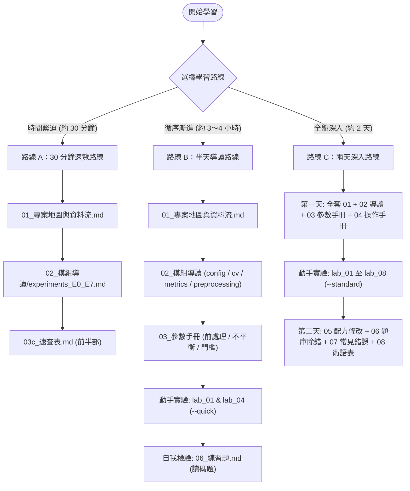
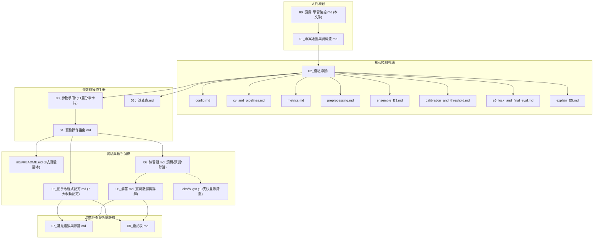

# 《企業破產預測專案》程式碼學習資料包 — 閱讀指南與學習路線

本資料包旨在為學習者提供《企業破產預測專案》（Bankruptcy Prediction Project）之全面程式碼導讀、數理統計原理、參數配置機制與動手實驗環境。本專案以高維度、極度不平衡之真實企業財務資料（破產盛行率約 3.23%）為背景，展示無資料洩漏的特徵工程、重複分層巢狀交叉驗證、分位數集成（Ensemble $E_A$）、工作點門檻轉移、機率校準與模型可解釋性之完整工程實踐。

---

## 1. 讀者對象與先備知識

- **目標讀者**：
  - 欲掌握金融風控、企業違約預測與極度不平衡分類實務之機器學習工程師或資料科學家。
  - 欲深入理解巢狀交叉驗證、無洩漏前處理管線與統計檢定校正之學習者。
  - 準備技術面試、欲建立具備工業級防護與嚴謹統計依據之作品集的求職者。
- **必備基礎**：
  - 基本 Python 程式能力（函式、類別、例外處理、模組引用）。
  - 基本資料處理套件使用經驗（pandas DataFrame 與 numpy 陣列操作）。
  - **不需具備進階機器學習或財經背景**：手冊中對所有專有名詞均提供最小數字例子與白話解說。
- **建議但非必需之前置閱讀**：
  - scikit-learn 官方教學之 Pipeline 與 Cross-Validation 基本概念。
  - ROC 曲線與 PR（Precision-Recall）曲線之基本原理。

---

## 2. 環境建置

本資料包與專案程式碼之相依套件與安裝步驟，**逐字取自專案之 `README_APP.md` 與 `requirements.txt`**。

### 2.1 支援版本與驗證環境
- **專案官方支援版本**：支援 Python 3.10 至 3.14（取自 `bankruptcy/README_APP.md:43`）。
- **本資料包驗證測試環境**：Python 3.14.4, Windows 11 (win32), pytest-9.1.1, scikit-learn 1.6+, LightGBM 4.6+, XGBoost 3.1+（取自 lab run manifest）。

### 2.2 建置步驟（逐字取自 `bankruptcy/README_APP.md`）

1. **進入專案目錄**：
   ```bash
   cd bankruptcy
   ```

2. **建立並啟用乾淨虛擬環境**：
   ```bash
   python -m venv .venv
   # Windows PowerShell:
   .venv\Scripts\Activate.ps1
   # Linux / macOS:
   source .venv/bin/activate
   ```

3. **安裝相依套件**：
   - **核心機器學習相依套件**（取自 `bankruptcy/requirements.txt`）：
     ```bash
     pip install -r requirements.txt
     ```
   - **應用與推論服務**（Streamlit + FastAPI，取自 `bankruptcy/requirements-app.txt`）：
     ```bash
     pip install -r requirements-app.txt
     ```
   - **測試套件相依**（執行 pytest，取自 `bankruptcy/requirements-test.txt`）：
     ```bash
     pip install -r requirements-test.txt
     ```

4. **驗證環境完整性**：
   在根目錄執行全套單元與整合測試（190 項測試，已追蹤測試檔；另有未追蹤測試檔 3 項）：
   ```bash
   python -m pytest bankruptcy/tests
   ```
   > [!NOTE]
   > 若看到 `190 passed` 且耗時約 1～2 分鐘，即代表環境配置成功（工作區另有未追蹤測試檔 3 項，共 193 項）。

---

## 3. 三條建議學習路線

> [!IMPORTANT]
> **時間標註宣告**：以下三條學習路線所標註之時間，**一律為閱讀時間估計，非實測**。實際時間視學習者背景與程式碼操作深度而定。



### 3.1 路線 A：30 分鐘速覽路線 (Executive / Quick Scan)
- **適合對象**：想在最短時間內掌握專案架構、核心商業價值與關鍵決策依據的讀者或技術主管。
- **閱讀順序**：
  1. [01_專案地圖與資料流.md](01_專案地圖與資料流.md)：理解 6,819 家公司資料的生命週期、全專案 9 大模組功能與無洩漏資料流。
  2. [02_模組導讀/experiments_E0_E7.md](02_模組導讀/experiments_E0_E7.md)：掌握從基準實驗（E0）到盲測集鎖定評估（E6）的核心結論與演進脈絡。
  3. [03c_速查表.md](03c_速查表.md) 前半部：快速查閱 M1～M5 固化參數、前處理旗標與四個工作點門檻清單。
- **執行指令**：無（純閱讀）。
- **預期收穫**：建立專案全景認知，理解為何在 3.23% 極端不平衡下「預警倍數（AR）」與「悲觀同分」是比 Accuracy 與單純 ROC-AUC 更具商業意義的指標。
- **估計時間**：閱讀時間估計，非實測（約 30 分鐘）。

### 3.2 路線 B：半天導讀路線 (Practitioner / Code Walkthrough)
- **適合對象**：希望理解專案核心演算法細節、深入前處理管線與交叉驗證設計的工程師。
- **閱讀順序**：
  1. [01_專案地圖與資料流.md](01_專案地圖與資料流.md)
  2. 核心模組導讀：
     - [02_模組導讀/config.md](02_模組導讀/config.md)：理解全域隨機種子 `SEED = 42` 與絕對路徑錨定機制。
     - [02_模組導讀/cv_and_pipelines.md](02_模組導讀/cv_and_pipelines.md)：掌握 5 折 × 3 次重複 = 15 次外層評估與管線內 fit-transform 防洩漏結構。
     - [02_模組導讀/metrics.md](02_模組導讀/metrics.md)：掌握 `AR@R` 數理定義、$\lceil R \times P \rceil$ 整數階梯與 Nadeau-Bengio 校正檢定。
     - [02_模組導讀/preprocessing.md](02_模組導讀/preprocessing.md)：掌握 `QuantileScaler` 厚尾對齊、常數欄剔除與相關性過濾漏斗（95 $\to$ 92 $\to$ 72 特徵）。
  3. 參數手冊精選：
     - [03_參數手冊/03_前處理.md](03_參數手冊/03_前處理.md)
     - [03_參數手冊/04_不平衡處理.md](03_參數手冊/04_不平衡處理.md)
     - [03_參數手冊/09_門檻與目標.md](03_參數手冊/09_門檻與目標.md)
  4. 執行沙盒實作（快速模式）：
     - 執行 `python labs/lab_01_tree_depth.py --quick`：親眼觀察單樹深度增加時的粗階梯同分與過擬合現象。
     - 執行 `python labs/lab_04_imbalance_strategies.py --quick`：親自驗證 SMOTE 對隨機森林無顯著增益、但使線性模型機率嚴重膨脹之機制。
  5. 自我評估：
     - 完成 [06_練習題.md](06_練習題.md) 中的「讀碼題（10 題）」並對照 [06_解答.md](06_解答.md)。
- **預期收穫**：通曉無洩漏機器學習架構，學會精確診斷同分問題與不平衡處置策略。
- **估計時間**：閱讀時間估計，非實測（約 3～4 小時）。

### 3.3 路線 C：兩天深入路線 (Deep Dive & Hands-On Engineering)
- **適合對象**：欲完整重現、改造專案、深入統計檢定、掌握除錯技巧與準備深度技術面試者。
- **日程規劃與順序**：
  - **第一天：全架構研讀與全套 Lab 驗證**
    1. 研讀 [01_專案地圖與資料流.md](01_專案地圖與資料流.md) 與全套 14 篇 [02_模組導讀](02_模組導讀/)。
    2. 研讀 [03_參數手冊](03_參數手冊/) 11 篇卡片與 [04_實驗操作指南.md](04_實驗操作指南.md)。
    3. 執行全套 8 支 Lab 腳本（`--standard` 完整模式，耗時約 35 分鐘）：
       ```bash
       python labs/lab_01_tree_depth.py
       python labs/lab_02_forest_hyperparams.py
       python labs/lab_03_boosting_f02.py
       python labs/lab_04_imbalance_strategies.py
       python labs/lab_05_preprocessing_ablation.py
       python labs/lab_06_recall_alert_curve.py
       python labs/lab_07_cv_folds_repeats.py
       python labs/lab_08_seed_stability.py
       ```
    4. 對照 [labs/README.md](labs/README.md) 核對實驗假設與實測快照數據。
  - **第二天：配方實作、沙盒除錯與面試準備**
    1. 研讀 [05_動手改程式配方.md](05_動手改程式配方.md)，在 `scratch/` 目錄中演練配方 1（新增 HistGradientBoosting 模型）與配方 2（新增自訂前處理 Transformer），驗證行獨立性。
    2. 挑戰 [06_練習題.md](06_練習題.md) 中的 8 道沙盒除錯題（另有 2 道因偏差未能於合成資料中穩定重現而移至 `labs/bugs/_wip/` 暫不列入），自行排查錯誤並對照 [06_解答.md](06_解答.md) 之 20 次重複量測數據。
    3. 完成 [06_小測驗.md](06_小測驗.md)（15 題選擇題）。
    4. 詳讀 [07_常見錯誤與除錯.md](07_常見錯誤與除錯.md) 與 [08_術語表.md](08_術語表.md)，掌握排查指令與精確定義。
- **預期收穫**：具備工業級機器學習系統除錯、架構擴充與應對最刁鑽技術追問之實戰能力。
- **估計時間**：閱讀時間估計，非實測（約 14～16 小時，分兩天進行）。

---

## 4. 專案目錄對照表

專案各目錄之定位、用途與對應導讀文件如下表所示：

| 目錄路徑 | 用途說明 | 對應教學導讀與文件 |
| :--- | :--- | :--- |
| `bankruptcy/data/` | 原始與切分資料集存放區（`data.csv` 6,819 家公司財報指標） | `01_專案地圖與資料流.md` |
| `bankruptcy/src/` | 專案核心原始碼庫（前處理、切分、訓練、評估、門檻、校準、解釋） | `02_模組導讀/` 全部模組 |
| `bankruptcy/outputs/` | 實驗輸出產物（CSV 報表、圖表、日誌，受唯讀防護保護） | `04_實驗操作指南.md` |
| `bankruptcy/outputs/models/final/` | 最終固化產物（凍結模型 `.joblib`、ECDF 分布 `.npy`、門檻表 `.json`） | `02_模組導讀/calibration_and_threshold.md` |
| `bankruptcy/tests/` | 專案正式單元測試與整合測試（190 項測試，工作區另有未追蹤測試檔 3 項） | `00_讀我_學習路線.md:2.2` |
| `bankruptcy/app/` | MVP Streamlit 互動式風控儀表板服務 | `02_模組導讀/app_streamlit.md` |
| `docs/code_learning/` | 本學習資料包全套說明文件、參數手冊與題庫 | 本手冊目錄與各章節 |
| `labs/` | 獨立實驗驗證腳本（lab_01 至 lab_08，不更動主專案產物） | `labs/README.md` |
| `labs/bugs/` | 沙盒除錯題庫（bug_01 至 bug_10，純合成資料） | `06_練習題.md`、`06_解答.md` |
| `tools/` | 資料包機器查核工具（`check_code_docs.py` 檢查器與單元測試） | `04_實驗操作指南.md` |

---

## 5. 閱讀本資料包時請記住的重大限制

在閱讀本資料包與評估專案結論時，學習者**必須時刻銘記以下客觀事實與限制邊界**，切勿過度解讀：

1. **測試集規模極小（44 家破產公司）**：
   專案 E6 盲測集僅有 44 家破產公司（佔 1,364 家測試樣本之 3.23%）。在 $R=0.90$ 工作點下抓出 43/44 家（97.7%），其 95% Clopper-Pearson 精確信賴區間為 $[87.98\%, 99.94\%]$，統計檢定力受樣本數限制較大。
2. **單一資料集，外部驗證尚未執行**：
   本專案資料取自台灣經濟新報（TEJ）去識別化資料庫。**外部驗證（External Validation on new market/time）尚未進行**，所有指標僅代表此單一資料集上之表現，不能直接外推為真實金融市場之普遍表現。
3. **缺乏企業識別碼與時間序列資訊**：
   資料集經完全去識別化，缺乏公司 ID 與財報年份，無法執行滾動時間序列（Rolling Window Split）或分群切分（GroupKFold），無法排除同一公司跨年度被重複抽樣之可能性。
4. **精準度限制與偽陽性成本**：
   在 $R=0.90$ 工作點下，預警精準度約為 12.8%，意味著發出的預警名單中有 **87.2% 為未破產之正常企業（誤警）**。在追求高召回的風控場景中，審查偽陽性必然伴隨龐大人力與稽核成本。
5. **F-02 部署版 M5 參數不一致**：
   調參 CV 階段 M5 啟用了 `subsample_freq=1`（每輪隨機特徵採樣），但最終凍結模型 `model_M5.joblib` 序列化為 `subsample_freq=0`。雖然 `lab_03` 45 組配對實測均值差僅 +0.0035 且未超出種子雜訊（0.0182），但**該觀察僅限於實驗樣本，不得任意向外推論至 E6 正式盲測**。
6. **E3 模型挑選存在輕微事後挑選偏誤**：
   E3 集成模型候選組合係於外層 15 次外層評估折驗證分數上進行比較選出，與單一模型評估共用外層評估折，存在輕微的事後挑選樂觀偏誤（經 Holm 校正確認集成與單模型無統計顯著差異）。
7. **Lab 實驗與專案正式實驗不預期逐位相同**：
   Lab 腳本旨在以輕量、獨立方式解構數理機制，雖使用相同種子，但抽樣策略與子集配置可能微調，數值走勢一致但各折指標不預期逐位相同。

---

## 6. 文件地圖 (Documentation Roadmap)

以下 Mermaid 流程圖展示資料包內各文件之間的架構關聯與建議閱讀路徑：


