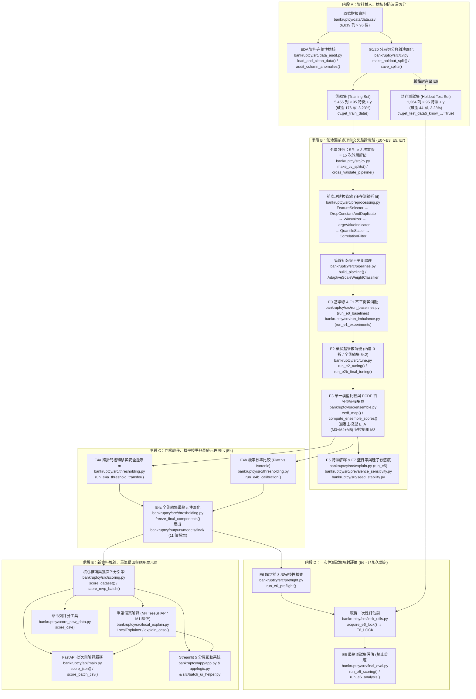
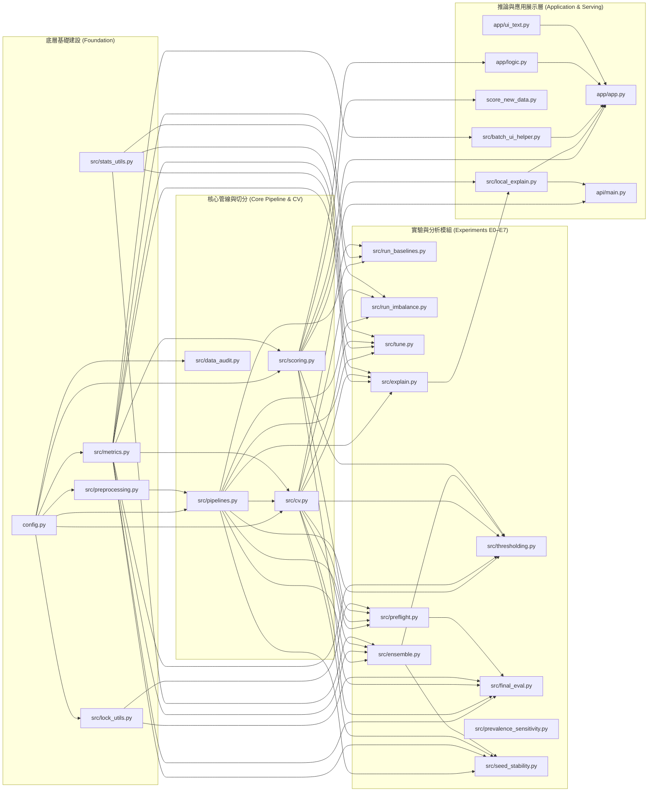

# 01 專案地圖與資料流 (`01_專案地圖與資料流.md`)

歡迎來到「企業破產預測」專案的第一站！對於剛接觸機器學習實務的學習者來說，面對二十幾支 `.py` 檔案與數十張實驗結果表，最容易迷失在細節裡。

本文件將帶你從高空俯瞰整個專案：從最原始的一張財報表格（`bankruptcy/data/data.csv`）出發，看懂資料如何一步步經過**體檢、隔離測試集、前處理瘦身、交叉驗證調參、多模型集成、機率校準與門檻設定**，最後變成命令列工具（CLI）、FastAPI 服務與 Streamlit 互動網頁上的風險預警結果。

---

## 1. 一頁式專案地圖：從原始資料到風險預警名單

下方流程圖展示了資料在專案中的完整生命週期。每個節點皆標註了實際執行的**檔案路徑（由專案根目錄起算）與核心函式／類別名稱**：



---

## 2. 專案內部模組依賴圖（誰呼叫誰）

本專案採用清晰的分層設計：底層為**設定、資料切分、前處理轉換器、評估指標與統計工具**；中層為 **E0～E7 實驗腳本與推論引擎**；頂層為 **CLI、FastAPI 與 Streamlit 介面**。



> [!TIP]
> **初學者讀碼順序建議**：先看 `Layer1`（`config.py`、`metrics.py`、`preprocessing.py`）與 `Layer2`（`pipelines.py`、`cv.py`），就能掌握 80% 的核心設計，再去讀 `Layer3` 的各個實驗腳本會非常輕鬆！

---

## 3. 資料形狀變化表與特徵漏斗（Feature Funnel）

在機器學習專案中，清楚掌握每一步的**列數（樣本數 $N$）**與**欄數（特徵數 $D$）**是除錯與防範資料洩漏的關鍵。以下所有數字均取自實際程式碼與 `bankruptcy/outputs/` 內的實測產物：

### 3.1 樣本切分與交叉驗證階段的列數變化

| 流程階段 | 負責模組與函式 (`檔案:行號`) | 輸入形狀 (列 × 欄) | 輸出形狀 (列 × 欄) | 正樣本數 (`Bankrupt? == 1`) | 資料型別與是否含標籤 | 證據來源 |
| :--- | :--- | :--- | :--- | :--- | :--- | :--- |
| **1. 原始 CSV 載入與欄名清理** | `bankruptcy/src/data_audit.py:45-50` (`load_and_clean_data`)<br>`bankruptcy/src/cv.py:204-205` | `(6819, 96)` | `(6819, 96)` | **220 家** (3.2263%) | `pd.DataFrame`（95 個 `float64`/`int64` 特徵 + 1 個 `int64` 目標欄 `Bankrupt?`） | `bankruptcy/outputs/tables/audit_summary.csv:2-9` |
| **2. 外層 80/20 分層切分** | `bankruptcy/src/cv.py:52-67` (`make_holdout_split`)<br>`bankruptcy/src/cv.py:197-251` (`get_train_data`, `get_test_data`) | `df: (6819, 96)` | **訓練集**：`X_train (5455, 95)`, `y_train (5455,)`<br>**測試集**：`X_test (1364, 95)`, `y_test (1364,)` | **訓練集**：**176 家** (3.2264%)<br>**測試集**：**44 家** (3.2258%) | `X`: `pd.DataFrame` (不含目標欄)<br>`y`: `pd.Series` (`int64`, 值為 0 或 1) | `bankruptcy/outputs/models/final/version_metadata.json:4-5`<br>`bankruptcy/outputs/e6/e6_operating_points.csv:2` |
| **3. 外層交叉驗證（5 折 × 3 次重複 = 15 次外層評估）** | `bankruptcy/src/cv.py:70-116` (`make_cv_splits`) | `X_train (5455, 95)` | **每次外層訓練折**：`(4364, 95)`<br>**每次外層驗證折**：`(1091, 95)` | **外層訓練折**：最小 **140**、最大 **141**、平均 **140.80 家**<br>**外層驗證折**：最小 **35**、最大 **36**、平均 **35.20 家** | 以索引陣列 `train_idx (4364,)`, `val_idx (1091,)` 切片 `X_train`, `y_train` | `bankruptcy/src/cv.py:97-115`<br>`bankruptcy/outputs/tables/e4b_calibration_summary.csv:2` |
| **4a. E2a 巢狀調參內層 3 折切分** | `bankruptcy/src/cv.py:254-290` (`make_inner_splits`, `n_splits=3`)<br>`bankruptcy/src/tune.py:292-297` | 外層訓練折 `(4364, 95)` | **內層訓練折**：`(2909~2910, 95)`（平均 `2909.33` 列）<br>**內層驗證折**：`(1454~1455, 95)`（平均 `1454.67` 列）<br>**內層 3 折合併 OOF**：`(4364,)` | **內層訓練折**：**93～94 家**（平均 **93.87 家**）<br>**內層驗證折**：**46～47 家**（平均 **46.93 家**）<br>**合併內層 OOF**：**140～141 家** | `inner_oof_scores`: `np.ndarray` (`float64`, 長度 `4364`) | `bankruptcy/src/tune.py:191-233` |
| **4b. E3 / E4a / E4b 外層訓練折內層 5 折參考分布切分** | `bankruptcy/src/ensemble.py:129-173` (`get_or_generate_reference_distribution`, `n_splits=5`) | 外層訓練折 `(4364, 95)` | **內層訓練折**：`(3491~3492, 95)`（平均 `3491.2` 列）<br>**內層驗證折**：`(872~873, 95)`（平均 `872.8` 列）<br>**外層訓練集 OOF 參考分布**：`(4364,)` | **內層訓練折**：**112～113 家**（平均 **112.64 家**）<br>**內層驗證折**：**28～29 家**（平均 **28.16 家**） | `ref_scores`: `np.ndarray` (`float64`, 長度 `4364`) | `bankruptcy/src/ensemble.py:150-171` |
| **4c. E2b 全訓練集調參與 E4c 最終參考分布（5 折 × 2 次重複 = 10 次評估）** | `bankruptcy/src/tune.py:856-862`<br>`bankruptcy/src/thresholding.py:619-682` | 全訓練集 `(5455, 95)` | **每次訓練折**：`(4364, 95)`<br>**每次驗證折**：`(1091, 95)`<br>**E4c 合併 2 次重複之最終參考分布**：`(10910,)` | **訓練折**：**140～141 家**<br>**驗證折**：**35～36 家**<br>**合併參考分布**：**352 筆** ($176 \times 2$) | `reference_M3.npy`, `reference_M4.npy`, `reference_M5.npy`: `np.ndarray` (`float64`, 長度 `10910`) | `bankruptcy/src/thresholding.py:671-682` |

---

### 3.2 前處理特徵漏斗（Feature Funnel）：從 96 欄到最終進入模型的 72 個特徵

在 `build_pipeline()`（`bankruptcy/src/pipelines.py:212-261`）中，特徵會依序通過以下前處理關卡。請特別注意**「2 對重複欄位」與「實際刪除 2 個欄位」**的區別，以及**相關性過濾門檻固定為 `|r| > 0.95`** 的實測結果：

| 漏斗順序 | 管線步驟名稱與類別 (`檔案:行號`) | 輸入特徵欄數 | 輸出特徵欄數 | 欄位與數值變化說明（附實測證據） |
| :--- | :--- | :---: | :---: | :--- |
| **起點** | 原始資料表 `data.csv` | 96 欄（含目標欄） | **95 個特徵欄** | 分離目標欄 `Bankrupt?` 後，共有 95 個原始財務特徵（`bankruptcy/outputs/tables/audit_summary.csv:4`）。 |
| **Step 1** | `feature_selector`<br>`FeatureSelector` (`bankruptcy/src/preprocessing.py:89`) | 95 欄 | **95 欄**<br>*(E5b 為 10/20/30 欄)* | 當 `features=None`（預設與最終模型設定）時，完整保留全部 95 個特徵並檢查無缺漏欄位。 |
| **Step 1b** | `imputer` *(選用)*<br>`TrainingMedianImputer` (`bankruptcy/src/preprocessing.py:34`) | 95 欄 | **95 欄** | 離線實驗（E0～E7）中 `use_imputer=False`（因原始資料 0 缺值）；MVP 批次推論元件（`outputs/models/mvp_extras/`）設為 `use_imputer=True`，以訓練折 95 欄中位數填補新資料之 `NaN`。 |
| **Step 2** | `drop_const_dup`<br>`DropConstantAndDuplicate` (`bankruptcy/src/preprocessing.py:132`) | 95 欄 | **92 欄**<br>*(固定刪除 3 欄)* | 1. **刪除 1 個常數欄位**：`Net Income Flag`（全體樣本數值恆為 `1`，標準差為 0；見 `bankruptcy/outputs/tables/constant_columns.csv`）。<br>2. **處理 2 對完全重複欄位**（見 `bankruptcy/outputs/tables/duplicate_columns.csv`）：<br>　- 第 1 對：`Current Liabilities/Liability` 與 `Current Liability to Liability` 數值完全相同 → 保留排在前面的 `Current Liabilities/Liability`，**刪除 `Current Liability to Liability`**。<br>　- 第 2 對：`Current Liabilities/Equity` 與 `Current Liability to Equity` 數值完全相同 → 保留排在前面的 `Current Liabilities/Equity`，**刪除 `Current Liability to Equity`**。<br>合計刪除 $1 + 2 = 3$ 欄，剩餘 $95 - 3 = \mathbf{92}$ 欄。 |
| **Step 3** | `winsorizer`<br>`Winsorizer` (`bankruptcy/src/preprocessing.py:183`) | 92 欄 | **92 欄** | - **E0 與 E1a**：設為 `enabled=True`（依訓練折 1% 與 99% 分位數裁剪二元旗標以外的連續特徵）。<br>- **E1b 消融後至最終模型（E2～E7、E4c 凍結模型）**：設為 **`enabled=False`**，特徵直接原樣通過，欄數維持 92 欄（`bankruptcy/outputs/models/final/version_metadata.json:43`）。 |
| **Step 4** | `large_value_indicator`<br>`LargeValueIndicator` (`bankruptcy/src/preprocessing.py:238`) | 92 欄 | **92 欄**<br>*(E1b 特例為 103 欄)* | - **預設與最終模型**：設為 **`enabled=False`**，欄數維持 92 欄。<br>- **僅在 E1b `large_indicator_on` 消融組**：設為 `enabled=True`，對訓練折中數值 $>1.0$ 比例介於 1%～99% 的雙峰欄位新增 `<col>__gt1` 指示欄（全訓練集上會新增 11 欄變為 103 欄）。 |
| **Step 5** | `scaler`<br>`QuantileScaler` (`bankruptcy/src/preprocessing.py:287`) | 92 欄 | **92 欄** | 預設與最終模型為 `kind="quantile"`，呼叫 `QuantileTransformer(output_distribution="normal", n_quantiles=min(1000, len(X)), random_state=42)` 將 92 個特徵轉換為標準常態分布，欄名與欄數維持 92 欄。 |
| **Step 6** | `corr_filter`<br>`CorrelationFilter` (`bankruptcy/src/preprocessing.py:338`) | 92 欄 | **全訓練集最終模型：72 欄** *(刪除 20 欄)*<br>**15 次外層評估折內：70～73 欄** *(平均 71.87 欄，眾數 72 欄)* | - **相關性門檻值確認**：`CorrelationFilter` 的預設值（`preprocessing.py:353`）、`build_pipeline`（`pipelines.py:249`）、E1b 消融實驗與 E4c 最終固化模型，門檻值 **`threshold` 一律為 `0.95`**（即 `|r| > 0.95`，從未使用 0.98）。<br>- **運作機制**：在 Step 5 縮放後的 92 個特徵上，計算訓練折內的 Pearson 相關係數矩陣 $|r|$ 以及每個特徵對訓練折標籤 `y` 的單變數調整後 ROC-AUC（$\max(\text{AUC}, 1-\text{AUC})$）；按單變數 AUC 由高到低排序貪婪挑選，凡與已入選特徵 $|r| > 0.95$ 者即剔除。<br>- **實測結果**：在全量訓練集（5,455 筆，`use_winsorizer=False`）上，剔除 **20 個高共線性特徵**，最終保留 **72 個特徵**進入分類器（驗證自 `bankruptcy/outputs/models/final/model_M3.joblib`, `model_M4.joblib`, `model_M5.joblib` 之 `corr_filter.selected_features_`）。在 5 折 × 3 次重複 = 15 次外層評估中，因各訓練折樣本略有不同，保留特徵數介於 **70～73 欄**（其中 10 次評估為 72 欄、3 次為 73 欄、1 次為 71 欄、2 次為 70 欄）。*(註：在 E1b 若開啟 `use_winsorizer=True`，於全訓練集上則剔除 16 欄、保留 76 欄。)* |
| **Step 7** | `resampler` *(僅 S2～S6)*<br>`SMOTE` 等 (`bankruptcy/src/pipelines.py:112`) | `(N_train, 72)` | `(N_resampled, 72)` | **不改變特徵欄數（72 欄）**，僅在 `fit()` 時增加訓練折內的少數類合成樣本（例如 `S3` `sampling_strategy=0.3` 會將少數類擴增至多數類的 30%）；推論 `predict_proba()` 時自動跳過此步驟。 |
| **Step 8** | `classifier`<br>M0～M5 分類器 (`bankruptcy/src/pipelines.py:131`) | `(N, 72)` | 預測機率向量 `(N,)` | 輸出正類（破產）原始預測機率 `predict_proba(X)[:, 1]`，再經 `scoring.py` 轉換為 ECDF 百分位分數 `score_E_A`、Platt 校準機率 `calibrated_prob_platt` 與各工作點預警旗標 `flag_E_A_R*`。 |

---

## 4. 防資料洩漏設計（Leak-Free Architecture）全清單

在極度不平衡（破產僅佔 3.23%）的小樣本財務資料中，只要前處理、特徵篩選、重抽樣或門檻設定不小心偷看了驗證折或測試集，評估指標就會出現虛假的高分。本專案在架構上建立了嚴密的防洩漏防線：

### 4.1 專案中每一個「只用訓練資料 fit」的關鍵位置

| 防護層級 | 模組與函式／類別 | 檔案路徑與行號 | 防洩漏機制說明 |
| :--- | :--- | :--- | :--- |
| **1. 測試集實體隔離與權限鎖** | `get_train_data()`<br>`get_test_data()` | `bankruptcy/src/cv.py:197-217`<br>`bankruptcy/src/cv.py:220-251` | `get_train_data()` 只回傳 `splits.joblib` 中 `train_idx` 的 5,455 筆資料；`get_test_data()` 若未顯式傳入 `i_know_this_is_final_evaluation=True` 立即拋出 `PermissionError`。 |
| **2. 切分索引防竄改校驗** | `compute_y_hash()`<br>`load_splits()` | `bankruptcy/src/cv.py:46-49`<br>`bankruptcy/src/cv.py:160-194` | 載入 `splits.joblib` 時自動比對資料總筆數（6,819）與目標欄 `Bankrupt?` 的 SHA-256 雜湊值，防止資料列順序變動導致訓練／測試索引錯位。 |
| **3. 缺失值中位數填補** | `TrainingMedianImputer.fit()` | `bankruptcy/src/preprocessing.py:47-61` | 僅在訓練折 `X` 上計算各欄位中位數 `self.medians_`，於 `transform()` 時套用至驗證／測試集。 |
| **4. 常數與重複欄位偵測** | `DropConstantAndDuplicate.fit()` | `bankruptcy/src/preprocessing.py:145-172` | 僅在訓練折 `X` 上判定常數欄（`nunique <= 1`）與完全相等欄位，記錄於 `self.selected_features_`。 |
| **5. 極端值縮尾邊界計算** | `Winsorizer.fit()` | `bankruptcy/src/preprocessing.py:198-216` | 僅在訓練折 `X` 上計算 `lower=0.01` 與 `upper=0.99` 分位數上下界，絕不使用驗證／測試集極值。 |
| **6. 雙峰大值欄位識別** | `LargeValueIndicator.fit()` | `bankruptcy/src/preprocessing.py:252-268` | 僅在訓練折 `X` 上統計 $>1.0$ 的樣本比例是否介於 1%～99%。 |
| **7. 分位數常態轉換擬合** | `QuantileScaler.fit()` | `bankruptcy/src/preprocessing.py:303-325` | `QuantileTransformer` 的經驗分位數分布（1,000 個分位點）與 `StandardScaler` 的均值／標準差，完全只在訓練折 `X` 上 `fit`。 |
| **8. 共線性相關矩陣與單變數 AUC 篩選** | `CorrelationFilter.fit()` | `bankruptcy/src/preprocessing.py:357-416` | Pearson 相關係數矩陣 `X.corr()` 與用來決定「高相關成對特徵誰該留下」的單變數 ROC-AUC（`roc_auc_score(y_arr, vals)`），完全只在訓練折 `(X, y)` 上計算。 |
| **9. 梯度提升樹動態正樣本權重** | `AdaptiveScaleWeightClassifier.fit()` | `bankruptcy/src/pipelines.py:62-80` | 策略 S1 下，XGBoost 與 LightGBM 的 `scale_pos_weight = n_neg / max(1, n_pos)` 在每次 `fit(X, y)` 時根據當下訓練折的 `y` 動態算出，避免使用全資料集比例。 |
| **10. SMOTE 合成少數類重抽樣** | `build_pipeline()` (`imblearn.pipeline.Pipeline`) | `bankruptcy/src/pipelines.py:212-261` | 使用 `imblearn.pipeline.Pipeline` 而非 `sklearn.pipeline.Pipeline`，確保 `SMOTE` 只在呼叫 `pipeline.fit(X_train_fold, y_train_fold)` 時重抽樣訓練折，呼叫 `pipeline.predict_proba(X_val_fold)` 時自動略過。 |
| **11. 巢狀 CV 內層超參數調優** | `create_inner_objective()`<br>`run_single_outer_fold()` | `bankruptcy/src/tune.py:181-253`<br>`bankruptcy/src/tune.py:259-355` | 在 E2a 的每次外層評估中，Optuna 只在 `outer_train_idx`（4,364 筆）切出的 3 個內層折上訓練與評估目標函數；選出固化參數後才在完整外層訓練折重擬合，並對外層驗證折（1,091 筆）預測一次。 |
| **12. ECDF 參考分布與 Stacking 特徵** | `get_or_generate_reference_distribution()`<br>`run_e3b_and_e3c()` | `bankruptcy/src/ensemble.py:129-173`<br>`bankruptcy/src/ensemble.py:417-520` | 為了將不同模型的原始機率轉成可相加的百分位，E3 在每個外層訓練折內部再做 5 折 CV 產生無洩漏的 `ref_scores`（4,364 筆），外層驗證折分數是查詢這份訓練折參考分布（`ecdf_map(ref_scores, val_scores_raw)`），絕不使用驗證折自身的排名來做正式部署評估。 |
| **13. 跨折決策門檻推導与機率校準** | `run_e4a_threshold_transfer()`<br>`run_e4b_calibration()` | `bankruptcy/src/thresholding.py:207-231`<br>`bankruptcy/src/thresholding.py:440-458` | 門檻 $t$（第 $\lceil (R+m) \cdot P_{\text{in}} \rceil$ 高之正樣本分數）與 Platt / Isotonic 校準器，皆僅在外層訓練折的內層 OOF 分數 `S_in` 與 `y_tr_outer` 上擬合，再直接套用至外層驗證折 `S_val`。 |
| **14. E5b 精簡特徵集挑選** | `run_e5()` | `bankruptcy/src/explain.py:612-689` | 在每次外層評估中，僅根據外層訓練折已擬合之 M3、M4、M5 內建特徵重要性平均排名挑出 Top $k \in \{10, 20, 30\}$ 特徵，再於外層訓練折重擬合、於外層驗證折評估。 |
| **15. E6 一次性測試集解封鎖定** | `run_e6_preflight()`<br>`acquire_e6_lock()`<br>`run_e6_scoring()` | `bankruptcy/src/preflight.py:59-313`<br>`bankruptcy/src/lock_utils.py:40-85`<br>`bankruptcy/src/final_eval.py:88-169` | 解封前驗證 11 個凍結元件 SHA-256 雜湊與訓練／測試索引無交集；評估前寫入 `outputs/logs/E6_LOCK` 並固化測試分數 `e6_test_scores.npz`，任何後續重跑評分的呼叫均會被 `E6_LOCK` 攔截並拋出 `RuntimeError`。 |

---

### 4.2 `get_train_data()` 唯讀安全性確認與 `labs/` 實驗守則

在後續第 4 階段（`labs/` 參數實驗腳本）中，學習者將親自動手跑實驗。在此我們根據 `bankruptcy/src/cv.py:197-217` 的實際原始碼確認其安全性：

```python
# bankruptcy/src/cv.py:197-217
def get_train_data(data_path: Union[Path, str, None] = None) -> tuple[pd.DataFrame, pd.Series]:
    if data_path is None:
        data_path = DATA_PATH
    df = pd.read_csv(data_path)
    df.columns = df.columns.str.strip()

    if not SPLITS_PATH.exists():
        save_splits(df)

    splits_data = load_splits(df=df)
    train_idx = splits_data["train_idx"]
    ...
```

> [!IMPORTANT]
> **`get_train_data()` 唯讀確認與 Lab 撰寫鐵則**
> 1. **無副作用確認**：由於 `bankruptcy/outputs/models/splits.joblib`（即 `SPLITS_PATH`）已經存在於磁碟上，`if not SPLITS_PATH.exists():` 恆為 `False`。因此呼叫 `get_train_data()` **是 100% 唯讀操作**：它不會覆寫 `splits.joblib`、不會觸發或讀取 `E6_LOCK`、也不會讀取 `test_idx`，只會回傳訓練集的 5,455 筆 `(X_train, y_train)`。
> 2. **Lab 腳本嚴格禁令**：
>    - 所有 `labs/lab_*.py` 腳本**只能呼叫 `get_train_data()` 與 `make_cv_splits(y_train)` / `make_inner_splits(...)`**（在 5,455 筆訓練集內部進行切分）。
>    - **嚴禁呼叫** `save_splits()`、`get_test_data()`，以及任何 `preflight.py`、`lock_utils.py`、`final_eval.py` 中的 E6 相關函式。
>    - 所有 Lab 產物一律寫入 `labs/outputs/`，**嚴禁寫入 `bankruptcy/outputs/`**。

---

## 5. 實驗階段（EDA、E0～E7）與程式碼模組、導讀檔案對照表

這張表幫助你在「看實驗報告（`RESULTS_SUMMARY.md`）」、「看程式碼（`bankruptcy/`）」與「讀本學習包導讀（`docs/code_learning/02_模組導讀/`）」之間自由切換：

| 實驗階段 | 實驗核心問題 | 主要執行腳本與相依模組 | 對應之 `02_模組導讀/` 文件 |
| :--- | :--- | :--- | :--- |
| **全域設定** | 專案路徑、隨機種子、CV 折數、目標召回率、MVP 常數定義在哪？ | `bankruptcy/config.py` | `02_模組導讀/config.md` |
| **EDA** | 資料有無缺值、常數欄、重複欄、極端大值、高共線性與近重複樣本？ | `bankruptcy/src/data_audit.py` | `02_模組導讀/data_audit.md` |
| **基礎建設** | 評估指標（AR@Recall、悲觀同分）、統計檢定（Nadeau-Bengio、Holm）、前處理與管線怎麼實作？ | `bankruptcy/src/metrics.py`<br>`bankruptcy/src/stats_utils.py`<br>`bankruptcy/src/preprocessing.py`<br>`bankruptcy/src/cv.py`<br>`bankruptcy/src/pipelines.py` | `02_模組導讀/metrics.md`<br>`02_模組導讀/preprocessing.md`<br>`02_模組導讀/cv_and_pipelines.md` |
| **E0** | 多特徵機器學習模型是否優於隨機猜測與單一最強財務指標？有無資料洩漏？ | `bankruptcy/src/run_baselines.py`<br>（呼叫 `cv.py`, `pipelines.py`, `metrics.py`） | `02_模組導讀/experiments_E0_E7.md` |
| **E1 (E1a/E1b)** | 哪種不平衡處理（S0～S6）與縮放器最好？Winsorizer、CorrFilter、LargeValueIndicator 該開還關？ | `bankruptcy/src/run_imbalance.py`<br>（呼叫 `cv.py`, `pipelines.py`, `stats_utils.py`） | `02_模組導讀/experiments_E0_E7.md` |
| **E2 (E2a/E2b)** | M1～M5 經過嚴格巢狀調參後有無顯著提升？超參數地景是否平坦？最終參數如何固化？ | `bankruptcy/src/tune.py`<br>（呼叫 `cv.py`, `pipelines.py`, `metrics.py`, `stats_utils.py`） | `02_模組導讀/tuning_E2.md` |
| **E3 (E3a–d)** | 5 個單一模型誰最強？ECDF 百分位等權集成（$E_A$）與 Stacking 表現如何？哪些破產公司最難抓？ | `bankruptcy/src/ensemble.py`<br>（呼叫 `cv.py`, `pipelines.py`, `metrics.py`, `stats_utils.py`） | `02_模組導讀/ensemble_E3.md` |
| **E4 (E4a–c)** | 訓練折訂出的門檻搬到驗證折會掉多少召回？安全邊際 $m$ 要加多少？Platt 與 Isotonic 誰適合？如何固化最終模型？ | `bankruptcy/src/thresholding.py`<br>（呼叫 `cv.py`, `ensemble.py`, `pipelines.py`, `metrics.py`, `scoring.py`） | `02_模組導讀/calibration_and_threshold.md` |
| **E5 (E5a/E5b)** | 哪些財務指標是驅動破產風險的關鍵？只用 Top 10/20/30 個精簡特徵夠不夠？單筆個案如何用 TreeSHAP 解釋？ | `bankruptcy/src/explain.py`<br>`bankruptcy/src/local_explain.py` | `02_模組導讀/explain_E5.md` |
| **E6** | 在嚴格封存、只看一次的 20% 測試集（44 家破產）上，固化模型與工作點是否全數達標？ | `bankruptcy/src/preflight.py`<br>`bankruptcy/src/lock_utils.py`<br>`bankruptcy/src/final_eval.py` | `02_模組導讀/e6_lock_and_final_eval.md` |
| **E7 (E7a/E7b)** | 當真實世界破產率降到 0.5%～1% 時精確率如何變化？換不同隨機種子結果穩不穩定？ | `bankruptcy/src/prevalence_sensitivity.py`<br>`bankruptcy/src/seed_stability.py` | `02_模組導讀/e7_sensitivity.md` |
| **推論與應用** | 如何對新公司 CSV 進行命令列評分、透過 FastAPI 提供服務，或在 Streamlit 進行互動式 What-if 模擬？ | `bankruptcy/src/scoring.py`<br>`bankruptcy/score_new_data.py`<br>`bankruptcy/app/app.py`, `app/logic.py`, `app/ui_text.py`<br>`bankruptcy/src/batch_ui_helper.py`<br>`bankruptcy/api/main.py` | `02_模組導讀/score_new_data.md`<br>`02_模組導讀/app_streamlit.md` |

---

## 6. 輸出目錄結構、命名慣例與報告自動溯源機制

本專案嚴格貫徹**「報告裡不手寫任何一個實驗數字」**的工程紀律。所有實驗輸出皆存放於 `bankruptcy/outputs/`（唯讀保護），並透過自動化腳本生成報告與驗證雜湊：

### 6.1 `bankruptcy/outputs/` 子目錄與檔案命名慣例

```text
bankruptcy/outputs/
├── tables/                                 # 所有實驗之結構化 CSV 數據表（報告唯一數字來源）
│   ├── audit_summary.csv, constant_columns.csv, duplicate_columns.csv,
│   │   large_value_columns.csv, low_cardinality_columns.csv,
│   │   high_correlation_pairs.csv, univariate_auc.csv, near_duplicates*.csv
│   ├── e0_baselines_summary.csv, e0_baselines_per_fold.csv, e0_label_shuffle.csv, ...
│   ├── e1a_imbalance_comparison.csv, e1a_paired_vs_s0.csv, e1b_ablation.csv, ...
│   ├── e2a_nested_summary.csv, e2a_nested_per_fold.csv, e2b_final_params_summary.csv, ...
│   ├── e3a_pairwise_models.csv, e3b_ensemble_summary.csv, e3d_hard_positives.csv, ...
│   ├── e4a_threshold_transfer_summary.csv, e4a_margin_recommendation.csv,
│   │   e4b_calibration_summary.csv, operating_points_for_report.csv
│   ├── e5a_permutation_importance.csv, e5a_shap_importance.csv, e5b_compact_summary.csv, ...
│   ├── e7a_prevalence_sensitivity.csv, e7b_seed_stability.csv, ...
│   ├── results_summary_sources.csv         # 記錄 RESULTS_SUMMARY.md 每個數字對應的 CSV 檔案、列與欄
│   └── mvp_model_card_metrics.csv          # 記錄 MODEL_CARD.md 每個數字的審計表
├── figures/                                # EDA、E0～E5、E7 產出之 PNG 視覺化圖表
├── e6/                                     # E6 最終測試集一次性評估產出（CSV 表與 PNG 圖，嚴禁覆寫）
│   ├── e6_test_scores.npz                  # 固化測試集預測分數（SHA-256 鎖定）
│   ├── e6_operating_points.csv, e6_ranking_metrics.csv, e6_paired_bootstrap.csv,
│   │   e6_calibration.csv, e6_vs_cv.csv, e6_hindsight_costs.csv, e6_missed_positives.csv
│   └── e6_*.png
├── models/
│   ├── splits.joblib                       # 固化之訓練/測試索引與 5 折 × 3 次重複外層切分
│   ├── best_params/                        # E2b 全訓練集固化超參數 (M1.json ~ M5.json)
│   ├── oof/                                # 各階段外層驗證折與內層參考分布之 OOF 分數 (.npy / .npz)
│   ├── final/                              # E4c 最終固化之 11 個核心推論元件（經 SHA-256 凍結保護）
│   │   ├── model_M3.joblib, model_M4.joblib, model_M5.joblib
│   │   ├── reference_M3.npy, reference_M4.npy, reference_M5.npy, reference_y.npy
│   │   ├── thresholds.json, thresholds.csv
│   │   ├── calibrator_platt.joblib, calibrator_isotonic.joblib
│   │   └── version_metadata.json
│   └── mvp_extras/                         # MVP 擴充推論元件（M1 模型、含 Imputer 管線、特徵中位數清單、Demo 批次檔與 SHA-256 清單）
└── logs/
    ├── e1_cache/, e2_cache/, optuna_studies/ # E1/E2 單折快取與 Optuna SQLite 資料庫
    ├── e6_preflight.txt                    # E6 解封前 8 項檢查通過紀錄與 11 個凍結檔 SHA-256 清單
    └── E6_LOCK                             # E6 一次性解封鎖定檔（禁止讀取、修改或刪除）
```

### 6.2 表格命名規則與自動生成報告流水線

1. **表格命名慣例**：
   - `<階段>_<主題>_per_fold.csv`：記錄 5 折 × 3 次重複 = 15 次外層評估中，每一次評估的明細數值（通常為 $15 \times \text{設定數}$ 列）。
   - `<階段>_<主題>_summary.csv`：由 `per_fold.csv` 聚合計算出的平均值（`_mean`）、標準差（`_std`）與合併 OOF（`_pooled_oof`）指標。
   - `<階段>_paired_vs_<基準>.csv`：記錄相對於基準設定（如 `S0`、`default`、單一模型）之 Nadeau-Bengio 校正配對 t 檢定差值、95% 信賴區間、Wilcoxon $p$ 值與 Holm-Bonferroni 校正後 $p$ 值（`p_holm`）。
2. **報告數字自動化溯源（Zero Hardcoded Numbers）**：
   - **`bankruptcy/scripts/make_results_summary.py`**：自動讀取 `bankruptcy/outputs/tables/` 與 `bankruptcy/outputs/e6/` 內的 CSV，動態組裝出 `RESULTS_SUMMARY.md`，同時將報告中每一個數字的「來源檔案、篩選條件、欄位名稱、原始精確值、格式化字串」寫入 `bankruptcy/outputs/tables/results_summary_sources.csv`，並由單元測試 `bankruptcy/tests/test_results_summary.py` 自動驗證。
   - **`bankruptcy/scripts/generate_mvp_report_and_card.py`**：自動由 OOF 分數與 E6 結果計算並產生 `bankruptcy/outputs/tables/mvp_model_card_metrics.csv` 與 `bankruptcy/MODEL_CARD.md`，並由 `bankruptcy/tests/test_mvp_completeness.py` 驗證所有數字與模型限制聲明分字不差。
   - **`bankruptcy/scripts/make_app_defaults.py`**：僅讀取訓練集 `get_train_data()` 與 `model_M3.joblib` 計算各財務特徵的分位數網格、中位數與虛擬角色預設值，輸出至 `bankruptcy/app/assets/defaults.json`，供 Streamlit 介面載入，並由 `bankruptcy/tests/test_app_defaults.py` 驗證與測試集完全隔離。
