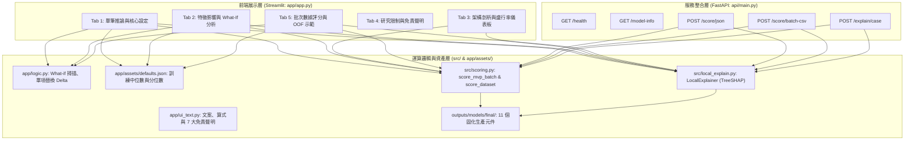

# 模組導讀：Web 應用與 API 服務架構 (`app/` 與 `api/`)

## 1. 模組定位與設計初衷

機器學習專案如果只停留在 Jupyter Notebook 或終端機腳本中，其商業價值就難以被非技術利害關係人（如風控經理、授信審查員、稽核團隊）所理解與採用。

本專案提供了完整的落地應用層架構：
1. **互動式前端展示系統（Streamlit，`bankruptcy/app/`）**：
   - 提供直觀的 GUI 介面，支援單筆情境試算、What-if 敏感度分析、動態特徵掃描、批次上傳排程與營運成本儀表板。
2. **高效能後端推論服務（FastAPI，`bankruptcy/api/`）**：
   - 提供標準 RESTful JSON 與批次 CSV 上傳 API，支援微服務整合與自動化管線調用。
3. **前端與後端的共同基石（`scoring.py` + `logic.py` + `ui_text.py`）**：
   - 共享相同的 11 個固化元件，嚴格保證前端介面與後端 API 的計算邏輯、門檻判定與數值輸出 100% 一致。

> [!IMPORTANT]
> **架構設計原則**：本導讀純粹以原始碼為依據進行靜態架構剖析，**不啟動任何 Streamlit 或 FastAPI 伺服器行程**。

---

## 2. 應用層系統架構圖

---

## 3. Streamlit 互動前端深度解析 (`bankruptcy/app/app.py`)

前端展示系統由 `bankruptcy/app/app.py` 驅動，透過 `st.tabs(ui_text.TAB_LABELS)` 劃分為 5 大核心功能分頁：

### 3.1 Tab 1：單筆推論與核心財報特徵設定 (`app.py:82-260`)
- **動態滑桿與折疊面板**：
  - **主要特徵（`EXPANDER_MAIN_TITLE`）**：將最重要的 18 個財務比率依特徵重要度排序，預設展開。每個特徵配備動態滑桿，範圍依據 `defaults.json` 的第 1 到第 99 分位數（`p01`～`p99`）設定，避免使用者輸入不合常理的極端數值。
  - **進階特徵（`EXPANDER_ADVANCED_TITLE`）**：其餘特徵預設折疊收合。
  - **補值透明化（`EXPANDER_FILL_TITLE`）**：未調整的財務欄位自動以訓練集中位數（`defaults.json` 中的 `medians`）填補，並明確向使用者說明補值機制。
- **即時風控判定**：
  - 即時計算 $E_A$ 整合評分與 Platt 校準後驗機率（`CALIBRATED_PROB_TITLE`）。
  - 對比固化的 R80～R100 門檻值，即時亮出「安全」或「高風險預警」警示燈。

---

### 3.2 Tab 2：特徵影響與 What-If 敏感度分析 (`app.py:265-420`)
- **單項特徵影響分解（Single-feature Replacement Effects）**：
  - 提供兩種分析視角（`bankruptcy/app/logic.py:25-90`）：
    - **Delta Drop**：將目前某特徵替換回「訓練集中位數」，觀察風險評分下降多少（衡量該特徵讓公司增加了多少風險）。
    - **Delta Add**：從基準中位數出發，僅將該特徵改為目前的數值，觀察風險評分上升多少（衡量該特徵的單獨危害力）。
- **特徵相對位置分布（Position Table）**：
  - 標示各特徵目前數值位於歷史母體的第幾百分位數（例如「負債比率處於前 98% 歷史極高危險區」）。
- **What-If 動態掃描曲線（`logic.py:95-165`）**：
  - 使用者可任選一項關鍵財務指標，系統自動沿著該特徵的歷史分位數（1～99 分位）進行等距掃描，即時繪製**風險分數變化曲線**。
  - 讓決策者直觀看清「若該公司的每股淨值再下降 10%，整體破產預警分數何時會跨越 R90 警戒線」。

---

### 3.3 Tab 3：模型架構與營運成本剖析 (`app.py:425-530`)
- **架構特徵漏斗展示**：
  - 視覺化呈現原始 95 維欄位 $\rightarrow$ 相關性過濾移除 20 欄 $\rightarrow$ 72 維核心特徵的管線流程。
- **門檻營運成本矩陣**：
  - 呈現 R80、R90、R95、R100 各點的捕獲數、預警比率與調查負擔。
- **盛行率敏感度儀表板（對接 E7a）**：
  - 動態呈現市場破產盛行率由 3.2% 變動至 0.5% 時，調查成本劇增的曲線與分析說明。

---

### 3.4 Tab 4：研究限制與免責聲明 (`app.py:535-560`)
- 整合 `ui_text.py` 的法規與學術合規聲明：
  - **資料集局限性**：說明資料來自特定歷史年代之台灣證交所上市公司，不可未經重新校準直接遷移至跨國市場或非公開發行中小企業。
  - **正例小樣本限制**：揭露測試集僅 44 家破產公司之抽樣不確定性。
  - **非投資或信貸保證**：聲明本系統僅供學術交流與風控決策輔助，不構成任何個別商業決策保證。

---

### 3.5 Tab 5：批次財務數據評分與 OOF 示範 (`app.py:565-860`)
- **雙模式運作**：
  - **OOF 驗證折示範模式（Demo Mode）**：直接載入歷史袋外驗證資料，讓使用者免上傳檔案即可體驗批次排程。
  - **上傳模式（Upload Mode）**：使用者可上傳包含 95 個財務欄位的 CSV 檔案。
- **生產級風控排程控制**：
  - 支援模型切換（$E_A$、M3、M4、M1）與工作點切換（R80～R100）。
  - **容量配額標註**：當資料量 $\ge 25$ 家時，自動標記 `in_batch_top_10_pct`（前 10% 高危險排程名單）。
  - **嚴格合規警示對照**：
    在介面顯著處提示 `ui_text.py` 的 7 大警語（小樣本抽樣誤差、R100 預警比例高、安全邊際外推未經正式驗證、SHAP 加法空間與集成非線性差異、共線性特徵歸因偏誤、校準機率先驗依賴、各模型風險分數尺度不同）。

---

## 4. FastAPI 後端推論服務設計 (`bankruptcy/api/main.py`)

為了支援現代雲端部署與微服務串接，`bankruptcy/api/main.py` 基於 FastAPI 實作了高效、強型別的 API 端點：

### 4.1 生命週期與元件單例管理 (`api/main.py:68-95`)
- 使用 FastAPI 的 `@asynccontextmanager`（Lifespan 機制）：
  在應用程式啟動時，一次性呼叫 `load_mvp_components()` 與 `load_final_components()` 將模型權重與 ECDF 參考陣列快取至全域變數，避免每次 HTTP 請求重複進行磁碟 I/O。

### 4.2 端點規範與功能對照

| HTTP 方法與路徑 | 入口函式 | 請求酬載 (Payload) | 回傳內容 (Response) | 設計重點與業務防護 |
|---|---|---|---|---|
| `GET /health` | `health()` | 無 | `{"status": "ok", "loaded": true}` | 容器化存活探針（Liveness Probe）檢驗元件載入狀態。 |
| `GET /model-info` | `model_info()` | 無 | 包含支援模型、預設工作點、R80～R100 門檻與中位數資訊 | 提供客戶端動態建構表單與門檻資訊。 |
| `POST /score/json` | `score_json()` | `ScoreJsonRequest` (包含單筆或多筆特徵字典、模型、工作點) | `ScoreJsonResponse` (風險分數、校準機率、預警旗標、批次排名) | 支援單筆或微型批次 JSON 評分；自動進行 20% 缺失率檢驗與中位數填補。 |
| `POST /score/batch-csv`| `score_batch_csv()` | `UploadFile` (串流 CSV 檔案) | 擴充評分欄位後的完整 CSV 串流或下載 | 大規模批次推論（如全行企業季報審核）；自動處理 UTF-8/BOM、同名欄位去重與悲觀排名排程。 |
| `POST /explain/case` | `explain_case_endpoint()` | `ExplainCaseRequest` (單筆特徵資料、目標模型、Top-K) | `ExplainCaseResponse` (SHAP Base Value、Top 貢獻特徵與數值) | 對接 `LocalExplainer`，即時產出單筆企業歸因分析。 |

---

## 5. 設計亮點與工程思維總結

1. **職責分離（Decoupling）**：
   - 核心演算法邏輯置於 `src/scoring.py` 與 `src/local_explain.py`。
   - 前端互動邏輯置於 `app/logic.py`，文字與聲明置於 `app/ui_text.py`。
   - API 路由僅負責 HTTP 序列化與狀態碼回傳。三者層次分明，維護性極佳。
2. **防禦性設計（Defensive Engineering）**：
   - 前後端均貫徹了 20% 缺失率防線、欄位去重、悲觀競爭排名與不可外洩防護，展現工業級軟體設計規格。
3. **可解釋與合規至上（Explainability & Compliance）**：
   - 不只給出冷冰冰的預測數字，更透過 What-if 掃描、SHAP 瀑布圖與嚴謹的 7 大免責聲明，兼顧商務實用性與法規透明度。
