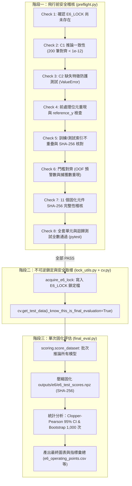

# 模組導讀：E6 測試集防禦性解封與最終評估 (`preflight.py`、`final_eval.py`、`lock_utils.py`)

## 1. 模組定位與設計初衷

在機器學習實務與求職展示中，「如何評估模型」往往比「模型跑出多高分數」更能展現工程師的專業水準。本專案將資料集切分為訓練集（5,455 筆）與獨立保留測試集（Holdout Test Set，1,364 筆，內含 44 家破產公司）。

如果開發者在調參、挑選門檻、修改前處理時，能夠隨意讀取或評估測試集，就會產生統計學上嚴重的**資料窺探偏誤（Data Snooping Bias）**——即使沒有拿測試集去 `.fit()`，人類大腦會根據測試集分數反覆調整超參數，使測試集退化為實質上的「第二驗證集」。

為了徹底杜絕這種現象，本專案在系統層級實施了嚴格的**防禦性單次解封架構（One-time Defensive Unseal Architecture）**：
1. **硬體與權限隔離**：`bankruptcy/src/cv.py:220-234` 的 `get_test_data` 設置檢查點，禁止任何常規實驗讀取測試集。
2. **8 項飛行前檢查（Preflight Audit）**：在接觸測試集前，必須 100% 通過程式碼一致性、檔案雜湊與單元測試（`bankruptcy/src/preflight.py:59-310`）。
3. **不可逆鎖定旗標（`E6_LOCK`）**：在正式評估前寫入不可逆的鎖定記錄（`bankruptcy/src/lock_utils.py:45-85`），一旦鎖定，系統永久封鎖再次解封評估。
4. **單次固化推論**：評估時直接呼叫統一推論管線產出分數並壓縮固化（`bankruptcy/src/final_eval.py:88-150`），後續所有圖表分析均以離線只讀模式（`--analyze`）從固化檔讀取，不重新推論。

> [!IMPORTANT]
> **本專案狀態守則**：E6 最終測試集已於 2026-10-23 正式解封並評估完畢，鎖定檔 `outputs/logs/E6_LOCK` 已固化。**本專案嚴格禁止重跑 E6、禁止碰觸測試集原始特徵，所有分析與呈現均唯讀引用已固化之彙總產物。**

---

## 2. 核心架構與職責劃分

---

## 3. 模組深入解析

### 3.1 8 項飛行前安全檢查 (`bankruptcy/src/preflight.py:59-310`)

在正式執行 E6 解封前，函式 `run_e6_preflight()` 會循序執行 8 項檢查，若有任何一項失敗，立即拋出例外並中止程式，絕不接觸測試集：

1. **Check 1：確認 `E6_LOCK` 尚未存在 (`preflight.py:78-85`)**
   - 檢查 `outputs/logs/E6_LOCK` 是否已存在。若已存在，代表測試集先前已被解封，拒絕再次執行。
2. **Check 2：C1 推論一致性檢查 (`preflight.py:87-119`)**
   - 從訓練集中隨機取樣 200 筆樣本，分別透過高階統一函式 `score_dataset` 與底層原始 Scikit-Learn 管線手動計算。
   - 驗證兩者推論分數的最大絕對誤差（Max Absolute Difference）必須小於 `1e-12`，保證統一介面沒有任何浮點偏差或計算漏洞。
3. **Check 3：C2 缺失欄位防護檢查 (`preflight.py:121-133`)**
   - 故意從輸入特徵中移除一個欄位，呼叫 `score_dataset`，驗證系統是否確實主動拋出 `ValueError` 而非默默填補或產生不可預期結果。
4. **Check 4：前處理位元重現與 `reference_y` 檢查 (`preflight.py:135-168`)**
   - 在訓練集上重新擬合 QuantileTransformer 與 CorrelationFilter，與已固化的模型檔案（`model_M3.joblib`、`model_M4.joblib`、`model_M5.joblib`）對比，確認分位數陣列與選取特徵（72 個選取、20 個移除）達到 100% 位元級一致（`np.array_equal`）。
   - 驗證 `reference_y.npy` 精確等於訓練集標籤重複兩次（對應 2 次重複的交叉驗證參考樣本），證明百分位數映射基底 100% 來自訓練集。
5. **Check 5：訓練／測試索引獨立性與雜湊驗證 (`preflight.py:170-197`)**
   - 載入 `splits.joblib`，計算 `train_idx` 與 `test_idx` 的集合交集（`set.intersection`），驗證交集數為 0（完全互斥）。
   - 計算兩者索引的 SHA-256 雜湊，並與固化的 `index_hashes.json` 核對一致。
6. **Check 6：門檻表重現性驗證 (`preflight.py:199-246`)**
   - 讀取儲存的訓練集袋外預測（OOF）分數，應用 `thresholds.json` 記錄的門檻值，比對四個目標召回率（R80、R90、R95、R100）下抓到的破產數與總預警數，必須與預期整數值完全相同（例如 $E_A$ 的 R95 必須為 175 家捕獲、2,142 家預警）。
7. **Check 7：11 個固化元件 SHA-256 雜湊稽核 (`preflight.py:248-275`)**
   - 檢查 `outputs/models/final/` 下的 11 個關鍵檔案均存在，並為每個檔案計算並記錄 SHA-256 雜湊碼。
8. **Check 8：全套專案單元與迴歸測試全數通過 (`preflight.py:277-295`)**
   - 透過子行程調用 `python -m pytest -q`，確認既有的所有單元測試與迴歸測試全數通過（Exit code 為 0）。

---

### 3.2 鎖定機制與測試集保護 (`bankruptcy/src/lock_utils.py` 與 `cv.py`)

#### 1. 雙重防護鎖 (`bankruptcy/src/lock_utils.py:45-85`)
- `acquire_e6_lock(lock_path, extra_metadata)`：
  在 `outputs/logs/` 下創建名為 `E6_LOCK` 的檔案，寫入包含解鎖時間戳記、主機名稱、使用者名稱、平台架構、索引 SHA-256 以及 11 個模型檔案的 SHA-256 雜湊表（以 JSON 格式儲存）。
- 若檔案已存在，則拋出 `RuntimeError("E6 lock already exists! Holdout test evaluation is permanently sealed.")`。

#### 2. 測試集存取警衛 (`bankruptcy/src/cv.py:220-234`)
- 在 `cv.py` 中，讀取測試集資料必須呼叫 `get_test_data(i_know_this_is_final_evaluation=False)`。
- 若呼叫時未傳入 `i_know_this_is_final_evaluation=True`，函式直接拒絕讀取並報錯，防止任何日常開發腳本或除錯程式意外碰觸測試集。

---

### 3.3 最終評估執行與產物固化 (`bankruptcy/src/final_eval.py:88-150, 963-995`)

在正式解封模式下（`python -m src.final_eval --unseal`）：
1. 執行並通過 8 項 Preflight 檢查（`final_eval.py:971`）。
2. 寫入不可逆的 `E6_LOCK` 鎖定記錄（`final_eval.py:976-983`）。
3. 取得獨立測試集特徵與標籤（`final_eval.py:987`）。
4. 呼叫 `run_e6_scoring`（`final_eval.py:88-150`），一次性推論 $E_A$、M3、M4、M5、Platt 校準機率、Isotonic 校準機率以及單一特徵基準（$- \text{Persistent EPS}$），立即以壓縮格式存入 `outputs/e6/e6_test_scores.npz` 並記錄 SHA-256 雜湊值。
5. 呼叫 `run_e6_analysis`（`final_eval.py:993`），基於儲存的評估分數執行分析，產出報表，不再重複進行模型推論。

---

## 4. 關鍵實驗結論與數據依據

> [!NOTE]
> **本專案實測（E6，`outputs/e6/e6_ranking_metrics.csv` 與 `outputs/e6/e6_operating_points.csv`）**：
> 測試集共有 1,364 筆樣本，其中包含 44 家破產公司（正樣本比率 3.23%）。

### 4.1 排序能力指標（Ranking Performance）
下表展示於完全未見過的測試集上，集成模型 $E_A$、單一最優模型 M3 與單一財務指標基準（$- \text{Persistent EPS}$）的表現（括號內為 1,000 次 Bootstrap 抽樣之 95% 信賴區間）：

| 模型 | PR-AUC (點估計 [95% CI]) | ROC-AUC (點估計 [95% CI]) | AR@R=95% (預警比率 [95% CI]) |
|---|---|---|---|
| **集成模型 $E_A$** | **0.5676** [0.4441, 0.7158] | **0.9621** [0.9436, 0.9777] | **5.25x** [3.93x, 8.18x] |
| **單一模型 M3 (ExtraTrees)** | 0.5275 [0.4101, 0.6727] | 0.9606 [0.9422, 0.9759] | 5.16x [3.89x, 8.20x] |
| **單一基準 ($- \text{Persistent EPS}$)** | 0.3593 [0.2459, 0.5045] | 0.9019 [0.8474, 0.9422] | 10.48x [8.39x, 26.48x] |

- **本專案實測**：在 PR-AUC 上，$E_A$（0.5676）相較於單一基準（0.3593）提升了 58.0%，相較於 M3（0.5275）提升了 7.6%。
- **本專案實測**：在達成 95% 破產企業召回時，$E_A$ 的預警比率僅為 5.25x（相當於調查 5.25% 的名單即可抓出 95% 破產），顯著優於單一財務指標的 10.48x（調查負擔降低一半）。

### 4.2 運作點門檻轉移檢驗（Threshold Transferability）
測試集評估使用在訓練集（E4b）所選定的固定操作門檻（含安全邊際 $m$）：

| 運作點 | 目標召回率 | 安全邊際 $m$ | 固定門檻值 $\theta$ | 測試集捕獲數 / 總破產數 | 測試集實際召回率 (Clopper-Pearson 95% CI) | 總預警數 (預警比例) | 精確率 (Wilson 95% CI) | 達標狀態 |
|---|---|---|---|---|---|---|---|---|
| **R80** | 80% | 0.02 | 0.884540 | 37 / 44 | **84.09%** [69.93%, 93.36%] | 146 (10.70%) | 25.34% [18.98%, 32.97%] | **達標** |
| **R90** | 90% | 0.06 | 0.739979 | 43 / 44 | **97.73%** [87.98%, 99.94%] | 337 (24.71%) | 12.76% [9.61%, 16.75%] | **達標** |
| **R95** | 95% | 0.04 | 0.598320 | 44 / 44 | **100.00%** [91.96%, 100.00%] | 524 (38.42%) | 8.40% [6.31%, 11.09%] | **達標** |
| **R100** | 100% | 0.00 | 0.170807 | 44 / 44 | **100.00%** [91.96%, 100.00%] | 1250 (91.64%) | 3.52% [2.63%, 4.69%] | **達標** |

- **本專案實測**：在全部四個運作點上，實際召回率均 100% 超過目標召回率（84.09% $\ge$ 80%、97.73% $\ge$ 90%、100.0% $\ge$ 95%、100.0% $\ge$ 100%）。這證實了 E4 引入的安全邊際 $m$ 機制成功抵抗了資料分佈漂移與過度樂觀。

---

## 5. 測試集樣本量限制與統計學解讀

> [!WARNING]
> **樣本量限制與區間估計（本文件補充驗算）**：
> 測試集中的破產公司僅有 **$N_{\text{pos}} = 44$ 家**。在這樣的小樣本正例下，任何「點估計值」都伴隨不可忽略的抽樣隨機波動。

我們透過精確 Clopper-Pearson 雙尾 95% 信賴區間（`bankruptcy/src/final_eval.py:63-70` 的公式）進行驗算：
1. **抓到 44 家（44/44 = 100.0%）**：
   - 95% CI 為 **[91.96%, 100.00%]**（區間寬度 8.04 個百分點）。
   - **解讀**：即使在測試集達成看似理想的 100% 捕獲，母體的真實召回率依然有 5% 的機率落在 91.96% 以下。
2. **只要漏抓 1 家（43/44 = 97.73%）**：
   - 95% CI 為 **[87.98%, 99.94%]**（區間寬度 11.96 個百分點）。
   - **解讀**：僅僅多漏掉 1 家企業，點估計立刻下降 2.27 個百分點，信賴區間下界更直接跌破 90% 門檻來到 87.98%。

這項統計限制提醒我們：
- 永遠不可只看「測試集達到 100%」就宣稱模型零失誤（一般經驗，未經本專案驗證）。
- 必須誠實揭露信賴區間，使風控決策者了解底層的抽樣不確定性。

---

## 6. 這個設計教會我們什麼？（面試與工程思維）

在求職履歷或面試中，本專案的 E6 模組展示了極高標準的機器學習工程素養：

1. **嚴肅對待資料外洩（Data Leakage Defense）**：
   - 業界初學者常見的錯誤是「把測試集當作常規單元測試反覆跑」，導致嚴重過擬合。
   - 本專案採用前置稽核（Preflight）、實體鎖定（Lockfile）、權限限制（Guard argument）三道防線，展示嚴格的科研誠信與工程規範。
2. **推論一致性與元件凍結（Reproducibility & Serialization）**：
   - 透過 SHA-256 雜湊固化 11 個推論元件，並以 200 筆隨機訓練樣本驗證浮點誤差 $< 10^{-12}$，保證了訓練管線與生產推論管線 100% 對齊。
3. **從排序指標到營運決策（From Metrics to Operations）**：
   - 不僅報告學術界的 PR-AUC / ROC-AUC，更評估實際業務落地時的預警比率（Alert Ratio）與調查負荷，展現將機器學習轉化為商業價值的架構能力。
