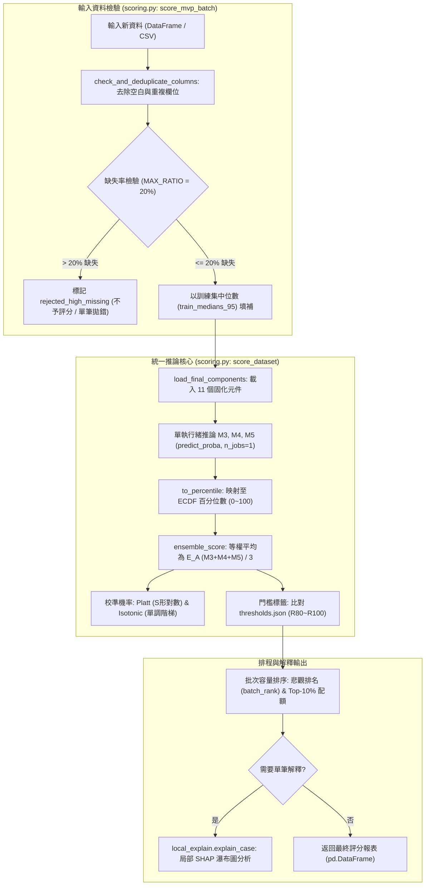

# 模組導讀：離線批次推論與單筆解釋 (`scoring.py`、`local_explain.py`)

## 1. 模組定位與設計初衷

機器學習模型在完成研發與測試後，最終目標是上線服務。一個可落地的推論系統必須解決四大核心挑戰：
1. **元件一致性（Frozen Component Loading）**：如何確保推論時使用的模型權重、前處理縮放器、特徵過濾器、ECDF 參考分佈與操作門檻，100% 來自訓練階段固化的產物，沒有任何隱性重擬合？
2. **防禦性資料檢驗（Defensive Data Ingestion）**：當外部業務系統上傳的資料包含欄位缺失、欄位順序錯亂、欄位名稱空白、重複欄位或極端缺失值時，系統如何優雅且安全地防護？
3. **同分悲觀排序與容量排程（Capacity Quota & Pessimistic Ties）**：有限的稽核人力（例如每週只能深入調查前 10% 的高風險企業）下，如何穩定產出排程名單？
4. **決策可解釋性（Decision Explainability）**：當系統將某家企業標記為高風險時，如何向審計師與風控主管提供清晰、可追溯的特徵貢獻解釋？

本專案由 `bankruptcy/src/scoring.py` 與 `bankruptcy/src/local_explain.py` 兩大模組共同實現了上述端到端推論架構。

---

## 2. 核心架構與推論管線



---

## 3. 模組深入解析

### 3.1 11 個固化元件的無縫載入 (`scoring.py:86-136`)

推論函式 `load_final_components(final_dir)` 會從 `outputs/models/final/` 目錄嚴格載入生產所需的 11 個固化元件，杜絕推論期動態擬合：
1. **模型管線檔（3 個）**：`model_M3.joblib`、`model_M4.joblib`、`model_M5.joblib`（包含擬合好的 QuantileTransformer、CorrelationFilter 與分類器）。
2. **ECDF 參考分佈檔（3 個）**：`reference_M3.npy`、`reference_M4.npy`、`reference_M5.npy`（訓練集 2 次重複交叉驗證產出的 10,910 筆參考分數）。
3. **門檻配置檔（2 個）**：`thresholds.json`、`thresholds.csv`（記錄 R80～R100 各運作點的精確門檻數值）。
4. **機率校準器（2 個）**：`calibrator_platt.joblib`、`calibrator_isotonic.joblib`。
5. **訓練標籤參考檔（1 個）**：`reference_y.npy`。

在載入模型後，程式會強制設定 `clf.set_params(n_jobs=1)`（`scoring.py:108`），確保跨執行緒推論時的位元級確定性，避免平行運算引發的浮點微小擾動。

---

### 3.2 20% 缺失率防禦與輸入校驗 (`scoring.py:382-480`)

在真實業務資料中，缺失值不可避免。`score_mvp_batch` 建立了多層防護機制：
- **欄位去重與空白清理 (`scoring.py:418-420`)**：
  呼叫 `check_and_deduplicate_columns` 去除欄位首尾空白，並檢查重複欄位，確保資料欄位與特徵字典精確對齊。
- **嚴格模式 vs. 容錯模式 (`scoring.py:445-459`)**：
  - 預設 `allow_missing=False`：若輸入資料缺少 95 個財務特徵中的任何一欄，或含有任何 NaN 值，立即拋出 `ValueError`。
  - 當設定 `allow_missing=True`：
    - 計算每筆樣本的缺失特徵比例 `missing_ratio = missing_count / 95.0`。
    - **$\le 20\%$ 缺失率（最多缺少 19 個特徵）**：以訓練集全體中位數 `train_medians_95` 進行填補。
    - **$> 20\%$ 缺失率（超過 19 個特徵缺失）**：標記為 `rejected_high_missing`，其風險分數與排名設為 `None`，且排除在批次排序母體之外。
    - 若單筆推論樣本的缺失率 $> 20\%$，系統直接拋出 `ValueError` 拒絕推論，防止模型在缺乏足夠財報資訊時給出荒謬預測。

---

### 3.3 排序排程與同分處理 (`scoring.py:402-414, 520-560`)

在批次推論（如每季評估全市場上千家公司）時，系統提供風控團隊所需的排程名單：
1. **悲觀競爭排名（`batch_rank`）**：
   - 採用悲觀排名（Pessimistic Max Rank）：若兩家公司分數相同（同分），兩者均賦予較大的排名數字（即同分時視為同樣危險，保守佔用名額）。
2. **Top-10% 稽核配額（`in_batch_top_10_pct`）**：
   - 當有效樣本數 $N_{\text{valid}} \ge 25$ 時，計算配額 $k = \lfloor N_{\text{valid}} \times 0.10 \rfloor$。
   - 邊界同分處理：採用穩定排序（以輸入順序，method='first'），確保最終標記的稽核數量嚴格等於配額 $k$，不會因為同分導致稽核人力超載。

---

### 3.4 單筆案件可解釋性對接 (`bankruptcy/src/local_explain.py:47-270`)

當某家公司被標記為高風險時，業務主管需要知道「具體是哪些財務指標出了問題」。`LocalExplainer` 提供了局部的特徵歸因分析：

```python
# 呼叫方式範例
from src.local_explain import get_local_explainer

explainer = get_local_explainer()
explanation = explainer.explain_case(
    case_features=company_x_features, # 單一企業 95 個財務欄位
    model_name="M3",                  # 選擇 ExtraTrees 模型
    top_k=5                           # 輸出前 5 大貢獻特徵
)
```

**內部運作流程**：
1. **前處理轉換（`local_explain.py:150-180`）**：
   使用已擬合的 QuantileTransformer 與 CorrelationFilter，將該單筆樣本由原始 95 維財報數值轉換為 72 維縮放特徵。
2. **TreeSHAP 邊際貢獻計算（`local_explain.py:185-210`）**：
   呼叫 `shap.TreeExplainer` 在對數勝算空間（Log-odds Space）計算每個特徵的 SHAP 值 $\phi_i$。
   $$
   \text{模型輸出} = \text{Base Value} + \sum_{i=1}^{72} \phi_i
   $$
3. **直觀解釋輸出（`local_explain.py:220-265`）**：
   - 輸出推升破產風險（$\phi_i > 0$）與降低破產風險（$\phi_i < 0$）的 Top-K 特徵名稱、原始數值與邊際貢獻值。
   - 繪製局部瀑布圖（Waterfall Plot），清楚展示「每股淨值過低推升了多少風險、負債比率過高又貢獻了多少風險」。
