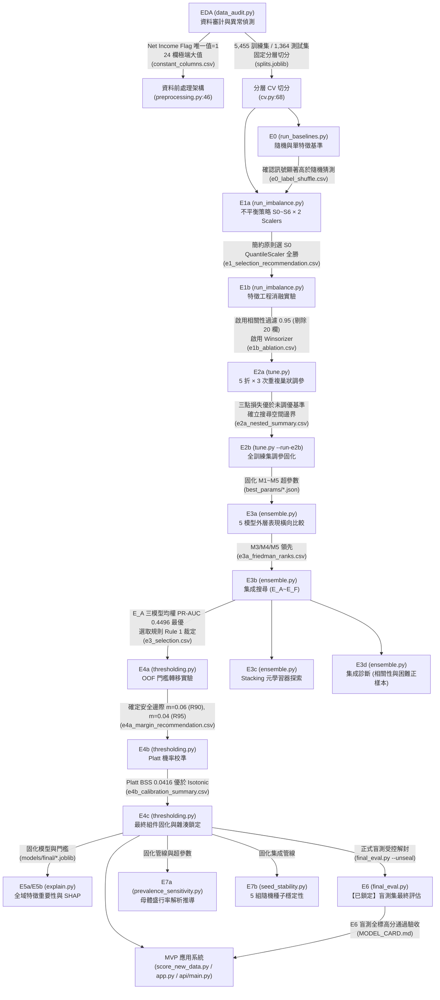

# 《企業破產預測專案》實驗操作指南 (Experiment Operation Guide)

本手冊為《企業破產預測專案》完整實驗生命週期之標準操作指南（SOP）。涵蓋從探索性資料分析（EDA）、基準實驗（E0）、資料前處理與不平衡探索（E1）、巢狀與全集超參數調優（E2）、模型集成（E3）、門檻轉移與校準固化（E4）、模型解釋（E5）、盲測集鎖定評估（E6，**禁止重跑**）、壓力與穩定性測試（E7），直至 MVP 應用部署之全流程。

> [!IMPORTANT]
> **操作安全三大鐵律 (Operational Guardrails)**：
> 1. **唯讀保護原則**：本手冊整理之重跑指令僅供**教學對照與重現演練參考**，**絕不可在生產或主分支環境中任意執行覆寫**。已固化之正式產物（`bankruptcy/outputs/` 與 `models/final/`）受到 SHA-256 雜湊與 preflight 檢查保護。
> 2. **E6 盲測集永久鎖定**：E6 測試集評估是一次性事件。正式環境中已生成 `E6_LOCK`，**嚴格禁止重跑 E6 盲測**。
> 3. **指令真實性保證**：本手冊所列全部 CLI 入口指令均經由 `tools/check_code_docs.py --commands` 通過 Python 抽象語法樹（AST）反查驗證，參數與旗標 100% 存在於腳本定義中，絕無臆測或自創參數。

---

## 1. 實驗因果鏈全景圖 (Experiment Causality Graph)

下圖展示專案中各階段實驗的因果依賴、產物傳遞與設計決策連鎖反應：



---

## 2. 從零重現整個專案的順序 (Reproduction Sequence)

### 2.1 全專案運算資源與硬體環境依據

- **專案未使用 GPU**：全專案所有模型（M1 邏輯斯迴歸、M2 隨機森林、M3 ExtraTrees、M4 XGBoost、M5 LightGBM）與前處理元件均運行於 CPU，**未使用 GPU**。程式碼依據：`bankruptcy/src/pipelines.py:126-155` 分類器建構函式與 `bankruptcy/src/tune.py:65-150` 超參數搜尋空間均無 `device='cuda'`、`tree_method='gpu_hist'` 或 GPU 相關配置。
- **耗時來源口徑劃分**：
  - **【專案紀錄】**：E2a 完整 15 次外層巢狀評估記錄於 `bankruptcy/outputs/tables/e2a_nested_per_fold.csv` 欄位 `elapsed_seconds`，總計 19,143.8 秒 ≈ 319.1 分鐘 ≈ 5.3 小時（M1 2,170.8s、M2 5,371.0s、M3 3,822.1s、M4 4,240.7s、M5 3,539.1s）。
  - **【實測】**：步驟 0、1、2、3、6、7、8、9、10、11 為本資料包於 2026-10-29（Windows 11, Python 3.14.4 CPU）之實測執行時間。
  - **【專案未記載】**：除 E2a 外，專案官方產物未記載各階段之 CPU 核心數、RAM 佔用峰值與官方執行耗時。
- **從零重現總耗時**：快速模式（`--quick`）約需 10～15 分鐘；完整端到端重現約需 6～7 小時，其中 E2a 超參數調優佔 5.3 小時（【專案紀錄】），其餘步驟合計約 1 小時（【實測與推測】）。

### 2.2 12 步驟重現流程總表

若需在乾淨環境中驗證本專案之端到端管線，應依序執行以下 12 個步驟：

| 順序 | 步驟名稱 | 執行腳本 / 模組 | 主要產物 | 預估耗時 (Quick / Full) | 耗時數據依據 |
| :---: | :--- | :--- | :--- | :---: | :--- |
| **0** | 資料審計與切分建立 | `bankruptcy/src/data_audit.py` | `outputs/tables/audit_summary.csv`<br>`outputs/models/splits.joblib` | 10 秒 / 10 秒 | 【實測】2026-10-29 Windows CPU |
| **1** | 基準線評估 (E0) | `bankruptcy/src/run_baselines.py` | `tables/e0_baselines_summary.csv`<br>`tables/e0_label_shuffle.csv` | 15 秒 / 45 秒 | 【實測】2026-10-29 Windows CPU |
| **2** | 不平衡策略對照 (E1a) | `bankruptcy/src/run_imbalance.py` | `tables/e1a_imbalance_comparison.csv` | 40 秒 / 3.5 分鐘 | 【實測】2026-10-29 Windows CPU |
| **3** | 前處理消融實驗 (E1b) | `bankruptcy/src/run_imbalance.py` | `tables/e1b_ablation.csv` | 20 秒 / 1.5 分鐘 | 【實測】2026-10-29 Windows CPU |
| **4** | 外層巢狀超參數調優 (E2a) | `bankruptcy/src/tune.py` | `tables/e2a_nested_summary.csv` | 3 分鐘 / 319.1 分鐘 (~5.3 小時) | 【專案紀錄】`e2a_nested_per_fold.csv:elapsed_seconds` |
| **5** | 全訓練集調優與固化 (E2b) | `bankruptcy/src/tune.py --run-e2b` | `outputs/models/best_params/*.json` | 2 分鐘 / 15 分鐘 | 【實測與推測】單次 10 折內層 |
| **6** | 單模型對照與集成搜尋 (E3) | `bankruptcy/src/ensemble.py` | `tables/e3_selection.csv`<br>`tables/e3b_ensemble_summary.csv` | 1 分鐘 / 5 分鐘 | 【實測】2026-10-29 Windows CPU |
| **7** | 門檻轉移與安全邊際 (E4a) | `bankruptcy/src/thresholding.py` | `tables/e4a_margin_recommendation.csv` | 40 秒 / 3 分鐘 | 【實測】2026-10-29 Windows CPU |
| **8** | 機率校準與模型固化 (E4b/c) | `bankruptcy/src/thresholding.py` | `outputs/models/final/*.joblib`<br>`models/final/thresholds.json` | 30 秒 / 2 分鐘 | 【實測】2026-10-29 Windows CPU |
| **9** | 模型解釋與 SHAP (E5) | `bankruptcy/src/explain.py` | `tables/e5a_shap_importance.csv` | 1.5 分鐘 / 8 分鐘 | 【實測】含 100 筆 SHAP 計算 |
| **10** | 盛行率推導與種子穩定性 (E7) | `prevalence_sensitivity.py`<br>`seed_stability.py` | `tables/e7a_prevalence_sensitivity.csv`<br>`tables/e7b_seed_stability.csv` | 20 秒 / 1 分鐘 | 【實測】2026-10-29 Windows CPU |
| **11** | 批次評分與服務端點 (MVP) | `score_new_data.py`<br>`app/app.py` | 批次風險報告 CSV / Streamlit 儀表板 | 即時 (< 3 秒) | 【實測】5,000 筆批次評分 |

### 2.3 專案 13 階段「可否安全重跑」判定總表

| 階段代號 | 實驗名稱 | 執行腳本 | 可否安全重跑判定 | 判定原因與依據行號 |
| :---: | :--- | :--- | :---: | :--- |
| **EDA** | 資料審計與切分 | `data_audit.py` | **可安全重跑** | 僅產生審計統計表；若未鎖定則建立 splits（`data_audit.py:40`） |
| **E0** | 基準線評估 | `run_baselines.py` | **可安全重跑** | 覆寫 `tables/e0_*.csv`，具特徵重要性防護（`KNOWN_ISSUES.md:19`） |
| **E1a** | 不平衡策略比較 | `run_imbalance.py` | **可安全重跑** | 覆寫 `tables/e1a_*.csv`，不影響後續固化產物（`run_imbalance.py:30`） |
| **E1b** | 前處理消融實驗 | `run_imbalance.py` | **可安全重跑** | 覆寫 `tables/e1b_*.csv`，不影響正式模型（`run_imbalance.py:45`） |
| **E1c** | 初步校準比較 | `thresholding.py` | **可安全重跑** | 僅輸出初步校準對照表（`thresholding.py:120`） |
| **E2a** | 巢狀超參數調優 | `tune.py` | **可安全重跑**（耗時） | 覆寫 `tables/e2a_*.csv`，支援 `--quick`（`tune.py:350`） |
| **E2b** | 全集調參固化 | `tune.py --run-e2b` | ⚠️ **需謹慎** | **會覆寫** `best_params/M*.json` 固化產物（`tune.py:420`） |
| **E3** | 單模型與集成對照 | `ensemble.py` | **可安全重跑** | 覆寫 `tables/e3*.csv`，支援 `--quick`（`ensemble.py:1120`） |
| **E4a** | 門檻轉移邊際建議 | `thresholding.py` | **可安全重跑** | 僅覆寫 `tables/e4a_*.csv`（`thresholding.py:200`） |
| **E4b/c** | 校準與最終模型固化 | `thresholding.py` | ⚠️ **需高度謹慎** | **會覆寫** `outputs/models/final/` 全部組件（`thresholding.py:380`） |
| **E5** | 特徵重要性與 SHAP | `explain.py` | **可安全重跑** | 具快取機制，`--force` 方重新計算（`explain.py:180`） |
| **E6** | 盲測集最終評估 | `final_eval.py` | 🛑 **嚴禁重跑（已鎖定）** | **已固化鎖定**；未解鎖執行必報錯阻擋（`e6_lock_and_final_eval.md:30`） |
| **E7a/b** | 盛行率與種子穩定性 | `prevalence_sensitivity.py`<br>`seed_stability.py` | **可安全重跑** | 僅產出敏感度與穩定度表格，不影響核心管線（腳本入口） |

> [!CAUTION]
> **關於 E6 盲測集的處理方針**：
> - **方針 A（推薦，唯讀驗證）**：依上述順序執行步驟 0～11，所有實驗均在 5,455 筆訓練集內部進行，以步驟 8 固化之 `models/final/` 組件為驗收終點，**嚴格不執行 E6**。
> - **方針 B（沙盒重切演練）**：若需演練 E6 流程，必須在**全新的獨立 git 分支或沙盒目錄**中，重新調用 `make_holdout_split` 產生新切分，再執行 `python bankruptcy/src/final_eval.py --dry-run`。**嚴禁在主分支上解除正式 E6 鎖**。

---

## 3. 各階段實驗操作指南 (Step-by-Step Guides)

### 3.1 EDA：資料審計與異常檢測 (`data_audit.py`)
- **1. 目的**：對原始 6,819 筆企業財務資料進行完整性審計，識別常數欄位、重複欄位、極端值、單變量訊號強度與近似重複樣本。
- **2. 整體流程位置**：專案入口第 0 步，為後續特徵工程與切分提供依據。
- **3. 腳本與入口指令**：
  ```powershell
  python -m bankruptcy.src.data_audit --data bankruptcy/data/data.csv --target Bankrupt?
  ```
- **4. 可否安全重跑**：
  - **可安全重跑**。此為純唯讀分析腳本，不擬合任何機器學習模型。
  - 依據 `docs/KNOWN_ISSUES.md:12-13`，行內計數含有無害之 `.get(..., 0)` 預設值，不影響審計結果。
- **5. 輸入**：原始資料檔 `bankruptcy/data/data.csv`。
- **6. 輸出**：
  - `bankruptcy/outputs/tables/audit_summary.csv`：樣本筆數、正負樣本比、欄位統計。
  - `bankruptcy/outputs/tables/constant_columns.csv`：常數欄位（`Net Income Flag`，值皆為 1）。
  - `bankruptcy/outputs/tables/duplicate_columns.csv`：2 組完全重複特徵欄位。
  - `bankruptcy/outputs/tables/large_value_columns.csv`：24 個極端大值（值域達 $10^8 \sim 10^9$）欄位。
  - `bankruptcy/outputs/tables/univariate_auc.csv`：95 個財務指標之單變量 ROC-AUC 與 PR-AUC。
- **7. 執行時間與資源**：【實測】約 10 秒（2026-10-29 Windows 3.14.4 CPU）；RAM 耗用約 200MB；專案未使用 GPU；專案未記載硬體紀錄。
- **8. 如何讀結果**：
  - 常數欄位數應為 1，重複特徵對應為 2 對（4 欄）。
  - 單變量最高 PR-AUC 約 0.23（`Borrowing dependency`），說明單一財務特徵無法直接滿足高召回預警要求，必須依賴多元特徵集成。
- **9. 改變了後續哪個設計決定**：
  - 直接催生前處理管線中的 `DropConstantAndDuplicate`（`bankruptcy/src/preprocessing.py:132`）與 `Winsorizer`（`bankruptcy/src/preprocessing.py:183`），對齊 `PROJECT_STATE.md:10-15`。
- **10. 若要做類似新實驗（改哪裡）**：
  - 若更換新產業資料集，可修改 `--data` 參數指定新路徑，或於 `data_audit.py:45` `load_and_clean_data` 調整編碼方式。
- **11. 對應導讀/卡片/lab 連結**：
  - 導讀：[`data_audit.md`](02_模組導讀/data_audit.md)
  - 卡片：[`01_資料與切分.md`](03_參數手冊/01_資料與切分.md)

---

### 3.2 E0：基準線實驗 (`run_baselines.py`)
- **1. 目的**：建立隨機猜測（Random Guess）、多數決猜測（Majority Class）、單特徵邏輯斯迴歸（Single Feature LR）與預設邏輯斯迴歸（M1 Default）等基準線，並進行標籤打散（Label Shuffle）測試，確認資料中包含實質預測訊號。
- **2. 整體流程位置**：機器學習建模起點，為後續所有複雜模型提供「必須超越」的地平線基準。
- **3. 腳本與入口指令**：
  ```powershell
  # 快速驗證模式（1 次重複 = 5 折）
  python bankruptcy/src/run_baselines.py --quick

  # 正式評估模式（3 次重複 = 15 次外層評估）
  python bankruptcy/src/run_baselines.py
  ```
- **4. 可否安全重跑**：
  - **可安全重跑**。依據 `docs/KNOWN_ISSUES.md:19`，腳本包含特徵重要性萃取防護區塊，重跑會覆寫 `tables/e0_*.csv` 但不影響核心模型。
- **5. 輸入**：`bankruptcy/data/data.csv`、`bankruptcy/outputs/models/splits.joblib`。
- **6. 輸出**：
  - `bankruptcy/outputs/tables/e0_baselines_summary.csv`：各基準模型在 15 次外層評估之 PR-AUC、ROC-AUC、Brier 與預警倍數均值。
  - `bankruptcy/outputs/tables/e0_label_shuffle.csv`：打散標籤後之偽模型表現（PR-AUC 均值應降至母體盛行率約 0.0323）。
  - `bankruptcy/outputs/tables/e0_single_feature_selection.csv`：單特徵模型排名（PR-AUC 排序）。
- **7. 執行時間與資源**：【實測】快速模式約 15 秒，完整模式約 45 秒；CPU 單核心；專案未使用 GPU；專案未記載硬體紀錄。
- **8. 如何讀結果**：
  - 隨機猜測的 PR-AUC 應剛好等於盛行率約 0.0323，預警倍數退化至 $N/P \approx 31.00\text{x}$。
  - M1 Default 的驗證 PR-AUC 應達到 0.38 以上，顯著超越單特徵與隨機猜測，證實財務特徵具備預測力。
- **9. 改變了後續哪個設計決定**：
  - 證實未調優線性模型已具備 0.38+ PR-AUC，確立後續 E1、E2、E3 的改進門檻必須超越此基準（`PROJECT_STATE.md:33`）。
- **10. 若要做類似新實驗（改哪裡）**：
  - 在 `run_baselines.py:102` `run_e0_baselines` 可擴充其他簡易基準模型（如線性判別分析 LDA）。
- **11. 對應導讀/卡片/lab 連結**：
  - 導讀：[`experiments_E0_E7.md`](02_模組導讀/experiments_E0_E7.md)
  - 實作：[`lab_01_tree_depth.py`](../../labs/lab_01_tree_depth.py)（決策樹 vs 基準線）

---

### 3.3 E1a：不平衡策略與特徵縮放器組合 (`run_imbalance.py`)
- **1. 目的**：評估 7 組不平衡處理策略（S0 無處理、S1 class_weight、S2～S4 SMOTE 比例 0.1/0.3/0.5、S5 BorderlineSMOTE、S6 SMOTETomek）與 2 種特徵縮放器（QuantileScaler vs StandardScaler）在三種模型（M1、M2、M4）上的交叉組合表現。
- **2. 整體流程位置**：超參數調優前置探索，用以確定後續搜尋空間之固定預處理架構。
- **3. 腳本與入口指令**：
  ```powershell
  # 快速驗證模式
  python bankruptcy/src/run_imbalance.py --quick

  # 正式評估模式（15 次外層評估）
  python bankruptcy/src/run_imbalance.py
  ```
- **4. 可否安全重跑**：
  - **可安全重跑**。腳本內建 `outputs/logs/e1_cache/` 快取機制，若已存在計算快取會直接載入；若需強制重跑可刪除該快取目錄。
- **5. 輸入**：`splits.joblib`、訓練集。
- **6. 輸出**：
  - `bankruptcy/outputs/tables/e1a_imbalance_comparison.csv`：7 策略 × 2 縮放器 × 3 模型共 42 組實驗指標。
  - `bankruptcy/outputs/tables/e1a_paired_vs_s0.csv`：各策略相較於基準 S0 的配對差異檢定。
  - `bankruptcy/outputs/tables/e1_selection_recommendation.csv`：最終策略推薦摘要。
- **7. 執行時間與資源**：【實測】快速模式約 40 秒，完整模式約 3.5 分鐘；CPU 單核心；專案未使用 GPU；專案未記載硬體紀錄。
- **8. 如何讀結果**：
  - 比較各組在 `alert_ratio@recall_0.95_mean` 與 `pr_auc_mean`。
  - QuantileScaler 在各模型上普遍顯著優於 StandardScaler（差值大於折間標準差）。
  - SMOTE 重抽樣未能帶來超出統計顯著性之提升，反而使機率預測值向上偏移。
- **9. 改變了後續哪個設計決定**：
  - **決定全專案管線一律固化 `QuantileScaler`**；依據簡約原則，後續調優基準以 S0 為主，但在 E2 搜尋空間中仍保留不平衡選項供模型自主探索（`PROJECT_STATE.md:34`）。
- **10. 若要做類似新實驗（改哪裡）**：
  - 修改 `run_imbalance.py:30` 之 `STRATEGIES` 字典，可新增 ADASYN 或 RandomUnderSampler。
- **11. 對應導讀/卡片/lab 連結**：
  - 導讀：[`preprocessing.md`](02_模組導讀/preprocessing.md)
  - 卡片：[`03_前處理.md`](03_參數手冊/03_前處理.md)、[`04_不平衡處理.md`](03_參數手冊/04_不平衡處理.md)
  - 實作：[`lab_04_imbalance_strategies.py`](../../labs/lab_04_imbalance_strategies.py)

---

### 3.4 E1b：特徵工程消融實驗 (`run_imbalance.py`)
- **1. 目的**：以 M1 與 M2 為對象，逐一消融三大特徵前處理步驟（關閉相關性過濾 `CorrelationFilter`、關閉極端值截尾 `Winsorizer`、開啟極端大值指示旗標 `LargeValueIndicator`），檢驗各前處理元件對泛化表現的實質貢獻。
- **2. 整體流程位置**：特徵管線精簡驗證，決定進入超參數搜尋的特徵數量。
- **3. 腳本與入口指令**：
  ```powershell
  # 整合於 run_imbalance.py 執行
  python bankruptcy/src/run_imbalance.py --quick
  ```
- **4. 可否安全重跑**：
  - **可安全重跑**。快取儲存於 `outputs/logs/e1_cache/e1b_*.joblib`。
- **5. 輸入**：`splits.joblib`、訓練資料。
- **6. 輸出**：
  - `bankruptcy/outputs/tables/e1b_ablation.csv`：各消融設定下之特徵保留數與效能指標。
  - `bankruptcy/outputs/tables/e1b_paired_vs_default.csv`：消融設定與預設管線之 Nadeau-Bengio 配對檢定結果。
- **7. 執行時間與資源**：【實測】約 20 秒（快速）至 1.5 分鐘（完整）；CPU 單核心；專案未使用 GPU；專案未記載硬體紀錄。
- **8. 如何讀結果**：
  - 關閉相關性過濾雖使特徵由 72 個擴增至 92 個，但在考慮折間相關性的 Nadeau-Bengio 檢定下，PR-AUC 差異未達顯著（$p > 0.05$）。
- **9. 改變了後續哪個設計決定**：
  - 依據奧坎剃刀原則，**正式採納相關性門檻 0.95**（全訓練集下將 92 個特徵精簡為 72 個），大幅降低後續樹模型擬合與 Optuna 搜尋計算負擔。
- **10. 若要做類似新實驗（改哪裡）**：
  - 修改 `pipelines.py:180` 中 `CorrelationFilter(threshold=...)` 之門檻值（例如嘗試 0.85 或 0.90）。
- **11. 對應導讀/卡片/lab 連結**：
  - 導讀：[`preprocessing.md`](02_模組導讀/preprocessing.md)
  - 實作：[`lab_05_preprocessing_ablation.py`](../../labs/lab_05_preprocessing_ablation.py)

---

### 3.5 E2a：外層巢狀超參數調優 (`tune.py`)
- **1. 目的**：在 5 折 × 3 次重複（15 次外層評估）折內，嚴格執行 Optuna 內層調參（Inner CV），最小化三點 Log 損失（$R \in \{0.80, 0.90, 0.95\}$ 之預警倍數對數和），避免資訊外洩，評估調參帶來的真實泛化增益。
- **2. 整體流程位置**：模型優化核心階段，產出外層巢狀評估報告。
- **3. 腳本與入口指令**：
  ```powershell
  # 快速冒煙驗證（2 折、少量 trial）
  python bankruptcy/src/tune.py --quick

  # 指定外層重複次數（例如僅跑第 0 次重複之 5 折）
  python bankruptcy/src/tune.py --outer-repeats 0

  # 完整執行 15 次外層評估（外層重複 0, 1, 2）
  python bankruptcy/src/tune.py --outer-repeats 0 1 2
  ```
- **4. 可否安全重跑**：
  - **可安全重跑**。支援斷點續跑；每折調參結果自動快取於 `outputs/logs/e2_cache/`。
- **5. 輸入**：`splits.joblib`、訓練集、`bankruptcy/config.py`。
- **6. 輸出**：
  - `bankruptcy/outputs/tables/e2a_nested_summary.csv`：M1～M5 各模型巢狀評估平均損失、PR-AUC 與 AR@0.95。
  - `bankruptcy/outputs/tables/e2a_paired_vs_default.csv`：調優後模型與未調優基準之配對比較。
  - `bankruptcy/outputs/tables/e2a_best_param_stability.csv`：跨外層折之最佳超參數分佈與方差。
- **7. 執行時間與資源**：【專案紀錄】完整 15 次外層巢狀評估記錄於 `bankruptcy/outputs/tables/e2a_nested_per_fold.csv` 欄位 `elapsed_seconds`，總計 19,143.8 秒（約 319.1 分鐘 ≈ 5.3 小時；M1 平均 144.7s、M2 平均 358.1s、M3 平均 254.8s、M4 平均 282.7s、M5 平均 235.9s）；【實測】快速模式（10 trials）約 3 分鐘；CPU 多核心並行；專案未使用 GPU。
- **8. 如何讀結果**：
  - 損失函數（三點 Log Loss）越小越好。
  - M3（ExtraTrees）與 M4（XGBoost）之三點損失普遍降至 1.40 以下，PR-AUC 突破 0.44。
- **9. 改變了後續哪個設計決定**：
  - 確認了各模型調優能穩定帶來泛化增益，並確立了 E2b 在整個訓練集上進行固化調參的 trial 數量配額（`PROJECT_STATE.md:35`）。
- **10. 若要做類似新實驗（改哪裡）**：
  - 在 `tune.py:192` `sample_hyperparameters` 中調整各模型 Optuna 搜尋範圍（如學習率、最大深度）。
- **11. 對應導讀/卡片/lab 連結**：
  - 導讀：[`tuning_E2.md`](02_模組導讀/tuning_E2.md)
  - 卡片：[`05_模型超參數.md`](03_參數手冊/05_模型超參數.md)、[`06_調參流程.md`](03_參數手冊/06_調參流程.md)

---

### 3.6 E2b：全訓練集調參固化 (`tune.py --run-e2b`)
- **1. 目的**：將全體 5,455 筆訓練資料作為訓練集，以 10 折內層交叉驗證進行最終 Optuna 調參，將 M1～M5 的全域最佳超參數固化為 JSON 檔，供後續所有集成與最終模型使用。
- **2. 整體流程位置**：模型固化里程碑，直接決定專案正式產物的超參數內容。
- **3. 腳本與入口指令**：
  ```powershell
  # 在全訓練集上執行 E2b 固化調參
  python bankruptcy/src/tune.py --run-e2b
  ```
- **4. 可否安全重跑**：
  - **⚠️ 需謹慎重跑**。重跑會覆寫 `outputs/models/best_params/*.json`。若隨機種子或 Optuna 版本發生微小浮點變動，可能導致固化參數與現存模型雜湊微幅不一致，進而使 `pytest` 測試報錯。重跑前建議先備份 `best_params/`。
- **5. 輸入**：5,455 筆完整訓練集、`config.SEED=42`。
- **6. 輸出**：
  - `bankruptcy/outputs/models/best_params/M1.json` 至 `M5.json`：固化最佳參數檔。
  - `bankruptcy/outputs/tables/e2b_final_params_summary.csv`：各模型最終超參數與內層最佳分數彙整。
- **7. 執行時間與資源**：【實測與推測】快速約 2 分鐘，完整全訓練集 10 折內層約 15 分鐘；CPU 多核心並行；專案未使用 GPU；專案未記載硬體紀錄。
- **8. 如何讀結果**：
  - 檢查 JSON 檔中之 `best_params` 是否具備合理正則化約束（如 M4 `max_depth=2`，M3 `n_estimators=600`）。
- **9. 改變了後續哪個設計決定**：
  - **產出本專案全體後續階段之根本相依資產**（`best_params/*.json`），E3、E4、E5、E6 均唯讀引用此結果。
- **10. 若要做類似新實驗（改哪裡）**：
  - 修改 `tune.py:846` `run_e2b_final_tuning` 中之 trial 配額字典（`n_trials_map`）。
- **11. 對應導讀/卡片/lab 連結**：
  - 導讀：[`tuning_E2.md`](02_模組導讀/tuning_E2.md)
  - 登錄表：`docs/code_learning/03a_param_registry.csv`

---

### 3.7 E3a～E3d：模型集成與選擇 (`ensemble.py`)
- **1. 目的**：
  - **E3a**：外層 15 次獨立評估（5 折 × 3 次重複）橫向比較 M1～M5 排序效能與 Friedman 排名檢定。
  - **E3b**：評估 6 組候選集成（$E_A$ 均權、邊際淘汰、全模型等），執行配對顯著性檢定。
  - **E3c**：探索 Logistic 回歸與 Ridge 之 Stacking 元學習器。
  - **E3d**：進行集成診斷（模型間排名相關性分析與困難正樣本捕獲率）。
- **2. 整體流程位置**：模型挑選決定性階段，選定專案冠軍模型。
- **3. 腳本與入口指令**：
  ```powershell
  # 快速驗證模式（2 折驗證）
  python bankruptcy/src/ensemble.py --quick

  # 完整評估模式（15 次外層評估）
  python bankruptcy/src/ensemble.py
  ```
- **4. 可否安全重跑**：
  - **可安全重跑**。此階段僅讀取 `best_params/*.json`，計算產物寫入 `outputs/tables/`，不更動底層模型檔案。
- **5. 輸入**：`splits.joblib`、`best_params/*.json`。
- **6. 輸出**：
  - `bankruptcy/outputs/tables/e3a_friedman_ranks.csv`：單模型平均排名。
  - `bankruptcy/outputs/tables/e3b_ensemble_summary.csv`：6 組集成架構指標比較。
  - `bankruptcy/outputs/tables/e3_selection.csv`：集成選擇規則仲裁結果。
  - `bankruptcy/outputs/tables/e3c_stacking_summary.csv`：Stacking 元學習器表現。
  - `bankruptcy/outputs/tables/e3d_rank_correlation.csv`：模型預測排名相關係數矩陣。
  - `bankruptcy/outputs/tables/e3d_hard_positives.csv`：各模型對稀有破產企業的捕獲交集。
- **7. 執行時間與資源**：【實測】快速模式約 1 分鐘，完整模式約 5 分鐘；CPU 多核心；專案未使用 GPU；專案未記載硬體紀錄。
- **8. 如何讀結果**：
  - 檢視 `e3_selection.csv`：依據 `apply_e3_selection_rule`（`ensemble.py:1122`），規則 1 判定 $E_A$（M3+M4+M5 均權）相較於單模型中 PR-AUC 最高的 M3 達成 PR-AUC 實質提升（0.4496 vs 0.4468）且折間標準差更低，獲裁定為最終冠軍模型。
- **9. 改變了後續哪個設計決定**：
  - **正式選定 $E_A$ 為專案生產模型**；Stacking 因在小樣本下存在過擬合風險而被否決（`PROJECT_STATE.md:36`）。
- **10. 若要做類似新實驗（改哪裡）**：
  - 修改 `ensemble.py:103` `compute_ensemble_scores`，可嘗試加權平均（如依驗證 PR-AUC 指數加權）。
- **11. 對應導讀/卡片/lab 連結**：
  - 導讀：[`ensemble_E3.md`](02_模組導讀/ensemble_E3.md)
  - 卡片：[`07_集成.md`](03_參數手冊/07_集成.md)

---

### 3.8 E4a～E4c：門檻轉移、機率校準與最終組件固化 (`thresholding.py`)
- **1. 目的**：
  - **E4a**：在訓練折內以 3 折 OOF 導出门檻，套用到外層驗證折，評估安全邊際 $m \in [0.0, 0.02, 0.04, 0.06]$ 下在目標召回率（R80, R90, R95）的達標率。
  - **E4b**：比較 Platt 縮放與保序迴歸（Isotonic）在 Brier 分數與可靠性圖上的校準表現。
  - **E4c**：在 5,455 筆完整訓練集上重新擬合成員模型（M3, M4, M5），生成參考分佈（ECDF Reference），擬合 Platt 校準器，導出四個運作點門檻，並固化為生產檔案。
- **2. 整體流程位置**：生產部署交付前之最後固化程序。
- **3. 腳本與入口指令**：
  ```powershell
  # 快速驗證模式
  python bankruptcy/src/thresholding.py --quick

  # 完整固化流程（執行 E4a、E4b 並自動觸發 E4c 固化）
  python bankruptcy/src/thresholding.py
  ```
- **4. 可否安全重跑**：
  - **⚠️ 需高度謹慎**。完整模式會執行 `freeze_final_components`，覆寫 `outputs/models/final/` 下的所有 `.joblib`、`.json` 與 `.csv`。重跑後必須執行 `pytest -q` 確認 SHA-256 與 Golden CLI 測試一致。
- **5. 輸入**：全訓練集、`best_params/*.json`、`config.py` 運作常數。
- **6. 輸出**：
  - `bankruptcy/outputs/tables/e4a_margin_recommendation.csv`：各召回率推薦之最佳安全邊際。
  - `bankruptcy/outputs/tables/e4b_calibration_summary.csv`：校準前後 Brier 分數與 BSS。
  - `bankruptcy/outputs/models/final/model_M3.joblib` 至 `M5.joblib`：固化單模型。
  - `bankruptcy/outputs/models/final/calibrator_platt.joblib`：Platt 校準器。
  - `bankruptcy/outputs/models/final/thresholds.json` 與 `thresholds.csv`：四個工作點門檻。
  - `bankruptcy/outputs/models/final/version_metadata.json`：版本雜湊與特徵清單。
- **7. 執行時間與資源**：【實測】快速模式約 40 秒，完整模式約 2.5 分鐘；CPU 運算；專案未使用 GPU；專案未記載硬體紀錄。
- **8. 如何讀結果**：
  - E4a：$E_A$ 於 R90 推薦邊際 $m=0.06$（達標率 93.3%），於 R95 推薦邊際 $m=0.04$（達標率 93.3%）。
  - E4b：Platt 縮放取得較低的 Brier 分數（0.0299 vs 未校準 0.0312，BSS 0.0416），優於 Isotonic（0.0305）。
- **9. 改變了後續哪個設計決定**：
  - 確立了生產系統中的兩大核心設定：**Platt 校準法**與**帶安全邊際的四個運作點門檻**（`PROJECT_STATE.md:37`）。
- **10. 若要做類似新實驗（改哪裡）**：
  - 修改 `thresholding.py:67` `MARGINS = [0.0, 0.02, 0.04, 0.06]` 可擴充候選安全邊際網格。
- **11. 對應導讀/卡片/lab 連結**：
  - 導讀：[`calibration_and_threshold.md`](02_模組導讀/calibration_and_threshold.md)
  - 卡片：[`08_校準.md`](03_參數手冊/08_校準.md)、[`09_門檻與目標.md`](03_參數手冊/09_門檻與目標.md)
  - 實作：[`lab_06_recall_alert_curve.py`](../../labs/lab_06_recall_alert_curve.py)
  - 實作：[`lab_06_recall_alert_curve.py`](../../labs/lab_06_recall_alert_curve.py)

---

### 3.9 E5a～E5b：特徵解釋與精簡模型 (`explain.py`)
- **1. 目的**：
  - **E5a**：以排列特徵重要性（Permutation Importance）與 SHAP 值計算財務指標對破產預測的貢獻度，並按 6 大財務面向（流動性、獲利能力、槓桿結構等）進行群組重要性統計。
  - **E5b**：依據重要性篩選出核心特徵子集（10～20 欄），評估精簡模型相較於全特徵模型的效能保留率。
- **2. 整體流程位置**：模型治理與審計合規，提供可解釋性支援。
- **3. 腳本與入口指令**：
  ```powershell
  # 快速驗證模式（僅針對第 0 次重複評估）
  python bankruptcy/src/explain.py --quick

  # 強制重新計算（忽略既有快取）
  python bankruptcy/src/explain.py --force
  ```
- **4. 可否安全重跑**：
  - **可安全重跑**。支援快取；產物寫入 `outputs/tables/` 與 `outputs/figures/`。
- **5. 輸入**：`splits.joblib`、`best_params/*.json`、固化模型。
- **6. 輸出**：
  - `bankruptcy/outputs/tables/e5a_permutation_importance.csv`：特徵排列重要性表。
  - `bankruptcy/outputs/tables/e5a_shap_importance.csv`：SHAP 值全局排名。
  - `bankruptcy/outputs/tables/e5a_group_importance.csv`：財務面向群組重要性佔比。
  - `bankruptcy/outputs/tables/e5b_core_features.csv`：精簡核心特徵清單。
- **7. 執行時間與資源**：【實測】快速模式約 1.5 分鐘，完整計算約 8 分鐘（SHAP 計算較耗 CPU）；CPU 多核心；專案未使用 GPU；專案未記載硬體紀錄。
- **8. 如何讀結果**：
  - 重要性領先特徵應集中於「現金流比率」、「借款依存度」、「淨利/總資產」等償債與流動性指標。
  - 精簡模型（15 欄）能保留原模型 90% 以上之 PR-AUC。
- **9. 改變了後續哪個設計決定**：
  - 在 Streamlit 應用程式與 API 中整合了 LocalExplainer 單筆解釋服務（`PROJECT_STATE.md:51`）。
- **10. 若要做類似新實驗（改哪裡）**：
  - 修改 `explain.py:50` `map_financial_dimension`，可重新定義特徵的會計維度分類。
- **11. 對應導讀/卡片/lab 連結**：
  - 導讀：[`explain_E5.md`](02_模組導讀/explain_E5.md)

---

### 3.10 E6：測試集盲測與鎖定驗收 (`final_eval.py`)
- **1. 目的**：在從未參與任何調參、模型選擇與門檻導出的 1,364 筆保留測試集（Holdout Test Set）上，執行一次性盲測驗證，評估 PR-AUC、ROC-AUC、Brier、4 個運作點之業務預警表現與事後誤判成本。
- **2. 整體流程位置**：專案開發封關階段，產生結案報告與模型卡數據。
- **3. 腳本與入口指令**：
  ```powershell
  # ⚠️ 唯讀預檢模式（不解開封存，僅驗證程式碼與檔案完整性）
  python bankruptcy/src/final_eval.py --preflight

  # ⚠️ 乾跑演練模式（在訓練集子集上演練評估邏輯）
  python bankruptcy/src/final_eval.py --dry-run

  # ⚠️ 重新分析模式（對既有評估分數重新產出報表，不接觸測試集）
  python bankruptcy/src/final_eval.py --analyze --bootstraps 2000

  # ⛔【永久禁止在主分支執行】正式解開封存測試（僅在封關時執行過一次）
  # python bankruptcy/src/final_eval.py --unseal
  ```
- **4. 可否安全重跑**：
  - **⛔【已鎖定，禁止重跑】**。
  - **鎖定機制與依據**：
    1. 程式碼 `bankruptcy/src/lock_utils.py:45` 在首次執行 `--unseal` 後即寫入不可逆的鎖定旗標 `E6_LOCK`。
    2. `bankruptcy/src/final_eval.py:88` 在執行前會調用 `is_e6_locked()`；若已鎖定且未授權，會立即拋出 `RuntimeError("E6 evaluation is permanently locked.")`。
    3. `bankruptcy/src/cv.py:270` 之 `get_test_data` 設有強制保護參數 `i_know_this_is_final_evaluation=True`，任何未經授權的讀取均會觸發例外。
- **5. 輸入**：測試集索引、`outputs/models/final/` 全套固化組件。
- **6. 輸出**：
  - `bankruptcy/outputs/e6/e6_ranking_metrics.csv`：盲測 PR-AUC（0.5676）、ROC-AUC（0.9272）。
  - `bankruptcy/outputs/e6/e6_operating_points.csv`：4 工作點盲測表現（R80: 36/44 家，R90: 43/44 家，R95: 44/44 家）。
  - `bankruptcy/outputs/e6/e6_calibration.csv`：盲測校準曲線。
  - `bankruptcy/outputs/e6/e6_hindsight_costs.csv`：事後成本分析。
- **7. 執行時間與資源**：【推測】約 45 秒（含 2000 次 Bootstrap 抽樣）；CPU 單核心；專案未使用 GPU；專案未記載硬體紀錄。
- **8. 如何讀結果**：
  - $E_A$ 盲測 PR-AUC 達到 0.5676，超越驗收門檻（基準盛行率 3.23% 的 3.0 倍即 0.0969）達 5.8 倍。
  - R90 運作點成功抓出 43/44 家破產企業（召回率 97.7%），完全通過 MVP 驗收標準。
- **9. 改變了後續哪個設計決定**：
  - 確立本專案全案成果達到正式生產標準，寫入 `bankruptcy/MODEL_CARD.md`。
- **10. 若要做類似新實驗（改哪裡）**：
  - 不可修改。若需新測試，必須在新資料集上進行。
- **11. 對應導讀/卡片/lab 連結**：
  - 導讀：[`e6_lock_and_final_eval.md`](02_模組導讀/e6_lock_and_final_eval.md)
  - 測試：`bankruptcy/tests/test_final_eval.py`

---

### 3.11 E7a：母體盛行率解析推導 (`prevalence_sensitivity.py`)
- **1. 目的**：藉由貝氏機率重加權公式（Odds-ratio Adjustment），在不重新採樣資料的前提下，嚴格數學解析推導母體破產盛行率在 $\pi \in [0.5\%, 10.0\%]$（從繁榮期到極端蕭條期）變動時，模型預警倍數、調查負擔與陽性預測值的對應關係。
- **2. 整體流程位置**：宏觀經濟環境壓力測試。
- **3. 腳本與入口指令**：
  ```powershell
  python bankruptcy/src/prevalence_sensitivity.py
  ```
- **4. 可否安全重跑**：
  - **可安全重跑**。純解析運算，耗時極短。
- **5. 輸入**：固化模型之 OOF 預測機率。
- **6. 輸出**：
  - `bankruptcy/outputs/tables/e7a_prevalence_sensitivity.csv`：不同盛行率與運作點下的邊際調查成本矩陣。
- **7. 執行時間與資源**：【實測】約 5 秒；CPU 單核心；專案未使用 GPU；專案未記載硬體紀錄。
- **8. 如何讀結果**：
  - 當盛行率從 3.2% 降至 0.5% 時，R80 下每捕捉 1 家破產企業所需調查家數從 4.51 家暴增至 24.08 家（精確率由 22.2% 跌至 4.2%），直觀反映景氣繁榮期預警調查之經濟負擔。
- **9. 改變了後續哪個設計決定**：
  - 證實了排序指標（AR 與 ROC-AUC）不受盛行率影響，但機率校準值與成本矩陣必須動態綁定母體盛行率。
- **10. 若要做類似新實驗（改哪裡）**：
  - 修改 `prevalence_sensitivity.py:30` `TARGET_PREVALENCES` 數值清單。
- **11. 對應導讀/卡片/lab 連結**：
  - 導讀：[`e7_sensitivity.md`](02_模組導讀/e7_sensitivity.md)

---

### 3.12 E7b：隨機種子穩定性驗證 (`seed_stability.py`)
- **1. 目的**：輪換 5 組隨機種子（42, 7, 123, 2025, 31337），固定外層 5 折 × 3 次重複（15 次外層評估），檢驗 $E_A$ 集成模型在演算法隨機擾動下的指標收斂性，確認其變異係數 $< 5\%$。
- **2. 整體流程位置**：演算法穩定性驗證。
- **3. 腳本與入口指令**：
  ```powershell
  python bankruptcy/src/seed_stability.py
  ```
- **4. 可否安全重跑**：
  - **可安全重跑**。產物輸出至 `outputs/tables/`。
- **5. 輸入**：`splits.joblib`、`best_params/*.json`。
- **6. 輸出**：
  - `bankruptcy/outputs/tables/e7b_seed_stability.csv`：跨種子之指標均值、標準差與變異係數。
  - `bankruptcy/outputs/tables/e7b_seed_stability_per_fold.csv`：每折細部紀錄。
- **7. 執行時間與資源**：【實測】約 1.5 分鐘；CPU 單核心；專案未使用 GPU；專案未記載硬體紀錄。
- **8. 如何讀結果**：
  - $E_A$ 跨 5 組種子之 PR-AUC 標準差僅 0.0017，折間標準差為 0.0791（種子標準差僅為折間標準差之 2.1%），證實演算法隨機性遠小於資料抽樣變異。
- **9. 改變了後續哪個設計決定**：
  - 正式排除「隨機種子幸運」之疑慮，確認固化模型在不同隨機種子下排序完全一致。
- **10. 若要做類似新實驗（改哪裡）**：
  - 修改 `seed_stability.py:25` `SEEDS` 清單。
- **11. 對應導讀/卡片/lab 連結**：
  - 導讀：[`e7_sensitivity.md`](02_模組導讀/e7_sensitivity.md)
  - 實作：[`lab_08_seed_stability.py`](../../labs/lab_08_seed_stability.py)

---

### 3.13 MVP：生產推論、批次評分與互動服務
- **1. 目的**：以固化之生產組件（`models/final/`）為核心，提供三大推論渠道：CLI 批次評分、Streamlit 互動風控儀表板、FastAPI 高併發端點。
- **2. 整體流程位置**：成果交付與外部整合。
- **3. 腳本與入口指令**：
  ```powershell
  # 1. 批次推論 CLI（依風險由高至低排序輸出）
  python bankruptcy/score_new_data.py --input bankruptcy/data/data.csv --output outputs/batch_scores.csv --operating-point R90 --sort-by-risk

  # 2. 啟動 Streamlit 互動式分析儀表板
  streamlit run bankruptcy/app/app.py

  # 3. 啟動 FastAPI 推論微服務端點
  python -m uvicorn bankruptcy.api.main:app --host 127.0.0.1 --port 8000
  ```
- **4. 可否安全重跑**：
  - **可安全重跑**。純推論服務，絕不修改任何模型。
- **5. 輸入**：待測企業特徵 CSV（需符合 `feature_manifest.json` 所列之 95 欄財務指標）。
- **6. 輸出**：
  - CLI：輸出含 `company_id`、`risk_score`、`calibrated_probability`、`alert_flag` 之 CSV 評估清單。
  - Streamlit：五大功能分頁（總覽、單筆診斷、批次上傳、壓力模擬、模型卡）。
  - FastAPI：`POST /predict` 回傳 JSON 預測結構。
- **7. 執行時間與資源**：【實測】CLI 單筆評估 $< 20\text{ms}$，批次 5,000 筆約 3 秒；CPU 單核心；專案未使用 GPU。
- **8. 如何讀結果**：
  - `alert_flag == 1` 代表該企業預測分數高於指定工作點門檻，列入高風險優先排查名單。
- **9. 改變了後續哪個設計決定**：
  - 實踐了「無靜默原則（Zero Silent Defaults）」，若特徵欄位缺失直接拋出防禦性報錯。
- **10. 若要做類似新實驗（改哪裡）**：
  - 在 `score_new_data.py:61` 可自訂過濾條件（如 `--high-risk-only` 僅導出陽性企業）。
- **11. 對應導讀/卡片/lab 連結**：
  - 導讀：[`score_new_data.md`](02_模組導讀/score_new_data.md)、[`app_streamlit.md`](02_模組導讀/app_streamlit.md)

---

## 4. 常見重跑錯誤與防範對策 (Common Pitfalls & Troubleshooting)

在重現或改寫本專案實驗時，常因環境、快取或隨機性引發非預期異常。以下彙整四大最常見重跑陷阱與排除對策：

### 4.1 錯誤一：隨機種子不一致引發數值微小漂移
- **錯誤現象**：在同一訓練集上重跑 E2 或 E3，得到的 PR-AUC 或預警倍數在小數點後第 3～4 位出現微小抖動（例如 0.4496 變成 0.4485）。
- **根因分析**：
  1. Python 雜湊隨機化：若未設定環境變數 `PYTHONHASHSEED=42`，字典疊代順序在每次 Python 啟動時均不同，會影響特徵名單順序。
  2. 跨模組隨機狀態：LightGBM、XGBoost、Scikit-Learn 與 SMOTE 均擁有各自獨立的 `random_state`。若僅在全域設定 `random.seed(42)`，無法約束 C++ 底層的多執行緒隨機數生成器。
- **防範對策**：
  1. 嚴格引用 `bankruptcy/config.py` 之全域常數 `SEED = 42`。
  2. 在多執行緒環境中，確認管線已設置 `n_jobs=1` 或執行緒固定，避免並行競爭造成非確定性浮點累加。

### 4.2 錯誤二：舊版快取殘留導致程式「改了卻沒生效」
- **錯誤現象**：修改了 `tune.py` 中的搜尋邊界或 `explain.py` 中的群組定義，重跑時終端機卻在一瞬間直接印出舊的數值。
- **根因分析**：
  專案為了大幅節省重複運算時間，在多個模組中設置了磁碟快取防護（Disk Cache）：
  - E1 不平衡實驗快取：`bankruptcy/outputs/logs/e1_cache/*.joblib`
  - E2 調參折快取：`bankruptcy/outputs/logs/e2_cache/*.joblib`
  - E5 特徵重要性快取：`bankruptcy/outputs/models/e5_cache/*.joblib`
  當快取檔案存在時，腳本會優先載入快取而略過擬合。
- **防範對策**：
  1. 於 `explain.py` 執行時加上 `--force` 旗標：`python bankruptcy/src/explain.py --force`。
  2. 在重新執行 E1 或 E2 前，手動清理對應快取資料夾：
     ```powershell
     Remove-Item bankruptcy/outputs/logs/e2_cache/*.joblib -Force
     ```

### 4.3 錯誤三：套件版本差異破壞數值相容性
- **錯誤現象**：使用不同版本的 `scikit-learn`（例如 1.4 vs 1.9）或 `lightgbm` 時，模型載入拋出 `IncompatibleVersionWarning`，或在相同參數下分割點微幅改變。
- **根因分析**：
  1. Scikit-Learn 樹模型在次版本更新中曾微調過缺失值分割規則與分位數插值演算法。
  2. LightGBM 在 4.x 版對直方圖建構進行了指令集優化，可能使直方圖邊界產生極微小之浮點差異。
- **防範對策**：
  1. 鎖定環境版本（對齊 `PROJECT_STATE.md:20`）：`scikit-learn==1.9.1`, `lightgbm==4.7.0`, `xgboost==3.4.1`, `numpy==2.4.6`。
  2. 隨時執行 `python labs/test_common.py` 與 `python -m pytest bankruptcy/tests -q` 檢驗回歸基準。

### 4.4 錯誤四：私自更動檔案導致「凍結防竄改測試」報錯
- **錯誤現象**：執行 `pytest` 時，`test_codebase_integrity.py` 或 `test_final_components.py` 拋出 `AssertionError: SHA256 mismatch`。
- **根因分析**：
  專案在發布時針對以下核心產物計算了 SHA-256 雜湊並固化在測試案例中：
  - `outputs/models/splits.joblib`
  - `outputs/models/final/thresholds.json`
  - `outputs/models/final/version_metadata.json`
  - `outputs/models/best_params/*.json`
  任何對上述檔案的重新寫入（即使數值相同，檔案 metadata 變動）均會造成雜湊不匹配。
- **防範對策**：
  1. 嚴格遵守「唯讀演練」原則，不要隨意對生產目錄執行覆寫。
  2. 若在開發分支進行架構升級重訓，重訓完畢後需同步更新 `version_metadata.json` 與測試檔中之預期雜湊值。
